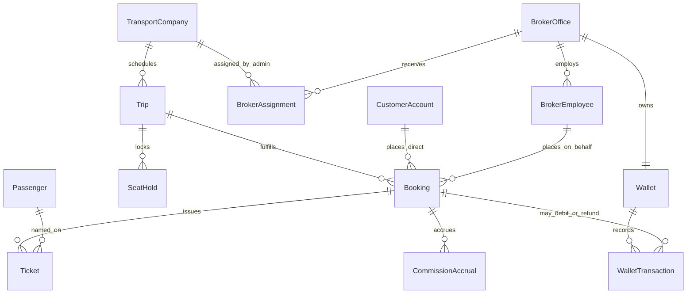

# ZoolGo Backend Requirements (Evidence-Backed)

**Authority rule:** Only workflows supported by supplied evidence. Missing workflows and unresolved authority are marked explicitly.  
**Primary source:** [`Zool/ZoolGo_Broker_Journey.pdf`](../Zool/ZoolGo_Broker_Journey.pdf) (local extract). Secondary: [`PROJECT_BRIEF.md`](PROJECT_BRIEF.md), [`REQUIREMENTS_AND_DECISIONS.md`](REQUIREMENTS_AND_DECISIONS.md), [`Zool/*.png`](../Zool/), Stitch (proposals only).

---

## 1. Actors

| Actor | Touchpoint | Evidence |
|---|---|---|
| Central Super Admin / admin team | Desktop admin dashboard | Project Brief §2.1; Stitch admin screens (ops UI proposal) |
| Broker office (agency) | Web broker panel | PDF §1–§6 |
| Broker employee / clerk | Sub-login under office | PDF §2, §3.1, §4 (staff management) |
| Ordinary customer | Mobile app | PDF §2 comparison; Project Brief §2.4 |
| Driver / conductor | Mobile app | Project Brief §2.5; mobile PNGs (`PassengerBoarding`, `QRScanner`, `Map`) |
| Transport company / carrier | Fleet & commission rates (no dedicated app in evidence) | PDF §2, §6 (sets broker commission %); Brief §2.3 |

**Missing as software:** broker panel, customer app, driver app, backend API. Requirements below describe **needed backend operations**, not existing code.

---

## 2. Entity distinctions (keep separate)

| Concept | Meaning | Evidence |
|---|---|---|
| Registered account vs passenger | Customer account books for self; broker books a **different** person | PDF §1 |
| Broker office vs employee | Agency wallet; multi-employee logins; permissions (booking-only vs booking+top-up+reports) | PDF §2, §4, §6 |
| Booking vs ticket | Booking confirmation yields ticket number / dispatch | PDF §3.11–§3.12 |
| Trip vs vehicle | Trip itinerary vs bus/plate/driver | Mobile `TripDetailsScreen`; Brief ER sketch |
| Seat hold vs confirmed seat | 15-min temporary lock; optional auto-assign; expiry returns to seat map | PDF §3.6–§3.7 |
| Payment vs refund | Instant wallet debit (broker) or Bankak (customer); cancel returns funds to payer channel | PDF §2, §3.10, §6 |
| Wallet movement vs commission accrual | Wallet debit = ticket price; commission accumulates separately unsettled | PDF §2 review line, §3.13, §6 |
| Commission settlement vs carrier settlement | Broker commission payout **manual**; periodic settlement date | PDF §6. Carrier revenue share: **Brief only — not PDF-confirmed** |
| Status axes | Trip / ticket / payment / GPS must not be collapsed into one enum | Implied by PDF states + boarding PNGs + tracking UI |

---

## 3. Required operations by surface

### 3.1 Central administration

| Operation | Status | Source |
|---|---|---|
| Assign carriers to brokers (exclusive visibility) | Required | PDF §2, §6 |
| Inspect bookings (customer + broker channels) | Required for admin product | Brief §3.2; Stitch `_5`–`_8` |
| Oversee broker wallet liquidity | Required | PDF wallet screens §4; Brief §3.6 |
| Manual commission payout / settlement action | Required | PDF §6 (صرف يدوي، ليس آلياً) |
| Record last settlement date per broker | Required | PDF §6 |
| Live fleet oversight | Product intent | Brief §2.1; mobile Map; Stitch tracking — **GPS protocol unconfirmed** |
| Approve top-ups via receipt queue | **Proposal** | Stitch `_24`; Brief §2.1 — **conflicts with PDF automatic credit** |
| Full GL / trial balance / disputes / RBAC enforcement | **Proposal / open** | Stitch; Brief framing |

### 3.2 Broker office and employees

| Operation | Status | Source |
|---|---|---|
| Login as office manager or authorized clerk | Required | PDF §2, §3.1 |
| See wallet balance + min-balance warning | Required | PDF §2, §3.2, §4 |
| Search trips **only** on assigned carriers | Required | PDF §2, §3.3, §6 |
| See price + **per-carrier** broker commission % | Required | PDF §2, §3.4, §6 |
| Seat hold 15 min or auto-assign; handle expiry | Required | PDF §3.6–§3.7 |
| Enter passenger PII (name, mobile, ID/passport as needed); multi-passenger | Required | PDF §3.8 |
| Review expected commission + post-debit balance | Required | PDF §3.9 |
| Instant wallet debit (no external gateway at checkout) | Required | PDF §2, §3.10, §6 |
| Block checkout on insufficient balance → top-up screen | Required | PDF §3.10, §5 |
| Confirm booking; dispatch WhatsApp / PDF / print | Required | PDF §3.11, §4 |
| Office booking list (filter by employee, carrier, date, status) | Required | PDF §3.12 |
| View accumulated unsettled commission + wallet ledger | Required | PDF §3.13, §4 |
| Top-up with minimum amount; dual confirmation paths (automatic after verified provider confirmation **and** MANUAL receipt review). **M1 production enabled path is MANUAL** until a real PSP is integrated; automatic remains architectural; mock confirm is non-production only | Required — **LOCKED (PDF + Stage 2.6)** in Decision Register D-TOP-01 (clarified 2026-10-23) | PDF §4 top-up screen; §6 آلية الشحن |
| Manager: manage clerks and permissions | Required | PDF §4 |
| Enforce booking volume / exposure ceiling | Required (numeric policy open) | PDF §5, §6, §7 |
| Cancel → refund to **agency wallet**; commission reduced | Required | PDF §2 cancel row; §6 commission rule |

### 3.3 Customer application

| Operation | Status | Source |
|---|---|---|
| Mobile + OTP login | Required | PDF §2; Brief §2.4 |
| Search **all** carriers | Required | PDF §2 |
| Seat hold / passenger / review / Bankak pay | Required | PDF §2 |
| Digital ticket in app | Required | PDF §2 |
| Cancel → refund to **original payment method** | Required | PDF §2 |
| Bankak payment confirmation integration details | **Unconfirmed** | PDF names Bankak gateway only |

### 3.4 Driver / conductor application

| Operation | Status | Source |
|---|---|---|
| Trip manifest / boarding checklist | Required (observed) | `PassengerBoarding.png` |
| QR / barcode ticket scan | Required (observed) | `QRScanner.png` (ref e.g. ZL-854921) |
| Live route / ETA display | Observed | `Map.png` |
| GPS stream source (phone vs IoT) | **Unconfirmed** | Brief §2.5 proposes both; Stitch proposes Teltonika |

---

## 4. Commission recognition (precise wording)

**PDF §6 — حساب العمولة (primary extract):**

> تراكمية — تزيد مع كل حجز، وتُخصم تلقائياً عند إلغاء التذكرة

**Also:**

- Review step shows **expected** commission for this booking before debit (PDF §3.9).  
- Wallet debit is instant at payment confirmation (PDF §3.10).  
- Commission display: accumulated, not yet disbursed (PDF §3.13).  
- Payout is **manual** by administration, not automatic (PDF §6).

**Do not invent** a more specific lifecycle event (e.g. “accrues only after ticket issuance”) unless PO clarifies. Backend must link commission change to **booking** and reverse on **ticket cancellation**, with open detail on the exact confirm boundary if payment and ticket issuance diverge.

---

## 5. Financial record integrity (engineering — not accounting-product approval)

Regardless of whether a full general ledger product is in scope, money-affecting operations require:

| Requirement | Rationale |
|---|---|
| Exact monetary representation | SDG amounts; avoid float drift |
| Idempotent operations | Duplicate payment notifications / retries |
| Atomic balance updates | Concurrent office employee debits |
| Concurrency protection | Seat holds and wallet races |
| Traceable references | Link wallet movements to booking IDs (PDF §4 statement of account) |
| Preserved history | PDF requires debit/credit history with dates |
| Linked reversals | Cancellation reduces commission and refunds wallet; no silent delete/edit of posted movements |

**Optional product (deferred):** chart of accounts, journals, trial balance, financial statements (Stitch). **LOCKED (PDF)** for M1: transaction records only — see Decision Register D-ACC-01.

---

## 6. Failure and concurrency requirements

Evidence-backed cases to design for; **do not invent unresolved business outcomes**.

| Scenario | Evidence | Required handling (engineering) | Unresolved business outcome |
|---|---|---|---|
| Concurrent seat selection | Seat inventory + 15-min hold (PDF §3.6) | Exclusive hold or conflict response | — |
| Seat-hold expiry before payment | PDF §3.7 | Release seat; return clerk to seat map | — |
| Concurrent wallet debits by clerks | Multi-employee office (PDF §2, §6) | Atomic debit; reject if insufficient | — |
| Insufficient balance | PDF §5 | Block booking; redirect to top-up | — |
| Booking limit exceeded | PDF §5–§6 | Reject over ceiling | Ceiling value / scope (PDF §7) |
| Unauthorized carrier | PDF §5–§6 | Reject | — |
| Below minimum top-up | PDF §5–§6 | Reject | Min amount scope (PDF §7) |
| Session expired mid-booking | PDF §5 | Safe abort; release holds | — |
| Duplicate payment notifications | Implied by payment confirm + idempotency needs | Idempotent credit / debit | Provider for top-up confirmation signal still OPEN; channel shape **LOCKED (PDF)** automatic — Decision Register D-TOP-01 |
| Payment confirmed, ticket issuance failed | PDF §5 lists ticket issuance failure among broker error cases | Compensate or retry without double charge | Exact recovery UX — unconfirmed |
| Cancellation + commission reversal | PDF §2, §6 | Wallet refund + commission decrease via linked reversal | Retention % tiers — Stitch proposal only |
| Duplicate boarding scans | QR boarding observed | Idempotent board event | Second-scan policy — unconfirmed |

---

## 7. Data relationships (minimum)

Constraints from PDF:

1. Broker may book only assigned carriers.  
2. Dual channels: customer+Bankak vs broker+wallet.  
3. Financial separation: wallet debit (ticket price) ≠ commission accrual.  
4. Same trip/seat inventory for both channels.

---

## 8. Authority boundaries

| Authority | Holder | Source |
|---|---|---|
| Carrier ↔ broker assignment | Super Admin only | PDF §6 |
| Broker commission % | Each transport company | PDF §6 |
| Commission payout | Central admin (manual) | PDF §6 |
| Settlement periodicity | Open numeric/policy | PDF §7 |
| Refund retention tiers | **Not in PDF** | Stitch proposal |
| Exceptional admin credit | **OUT OF SCOPE (PDF)** until future PO decision | Stitch/UI only — Decision Register D-ADJ-01 |
| Full accounting statements product | **Deferred** for M1 (transaction records only) | Stitch — Decision Register D-ACC-01 |
| Platform take-rate / carrier settlement formula | **Unconfirmed** | Brief mentions; not PDF |

---

## Related

- [`BACKEND_READINESS_AUDIT.md`](BACKEND_READINESS_AUDIT.md)  
- [`BACKEND_DECISION_REGISTER.md`](BACKEND_DECISION_REGISTER.md) — **Locked for next vertical (Broker Journey PDF)** binds M1 scope; Stage 1/M0 is complete without broker domain code  
- [`archive/stage-plans/STAGE1_PLAN.md`](archive/stage-plans/STAGE1_PLAN.md)  

