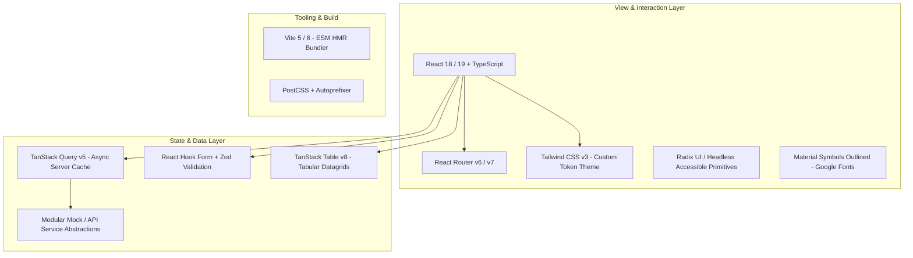
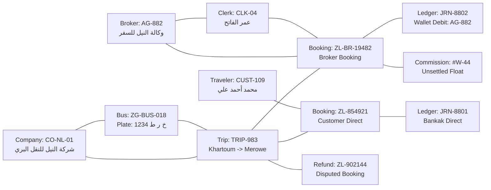

# ZoolGo Central Administration Dashboard — Frontend Architecture Document

## 1. Architectural Principles & Technology Stack

The ZoolGo Super Admin Dashboard is architected as a high-performance, single-page enterprise web application with native Right-to-Left (RTL) Arabic layout, dense operational tables, and interactive vehicle telemetry.

### Core Stack Recommendations



| Technology | Selected Tool | Rationale & Compatibility |
| :--- | :--- | :--- |
| **Frontend Framework** | **React (v18/19) + TypeScript** | Standard for high-density enterprise administrative portals; provides strict type safety for complex transit entities (trips, manifests, ledger entries). |
| **Build & Dev Tool** | **Vite** | Sub-second Hot Module Replacement (HMR), minimal configuration, instant TypeScript compilation, and optimized production chunking. |
| **Client-Side Routing** | **React Router (v6/v7)** | Robust nested layouts, path-based URL search params (`?corridor=northern`, `?tab=routes`), and declarative route loaders. |
| **Styling & Design System** | **Tailwind CSS (v3)** | Configured with the canonical tokens extracted from `DESIGN.md`. Zero runtime overhead, utility-first consistency, and native `rtl:` plugin support. |
| **Server State & Caching** | **TanStack Query (v5)** | Manages asynchronous data fetching, loading skeleton triggers (`_10`), empty states (`_9`), error recovery dialogs (`_11`), and optimistic UI mutations. |
| **Forms & Validation** | **React Hook Form + Zod** | Uncontrolled high-performance inputs with type-safe schema validation for wallet top-ups, role building, and broker assignment forms. |
| **Data Tables** | **TanStack Table (v8)** | Headless table logic powering high-density data tables across bookings, ledger transactions, and fleet inventories without imposing UI constraints. |
| **Accessible Primitives** | **Radix UI Primitives** | Unstyled, fully accessible primitives for Dialogs, Slide-over Drawers, Dropdown Menus, Tabs, and Tooltips, styled via Tailwind. |
| **Iconography** | **Material Symbols Outlined** | 100% fidelity to the Stitch export iconography; loaded via Google Fonts or bundled SVG components. |
| **Telemetry / Map** | **Interactive SVG Canvas / Leaflet** | Follows the vector GIS approach demonstrated in Stitch `_13` (Sudan corridor road network) without requiring paid Mapbox or Google Maps billing keys. |

---

## 2. Shared Application Shell & Navigation

The application shell provides the framing context across all 10 platform modules:

```
+---------------------------------------------------------------------------------------------------+
|  PERSISTENT TOP OPERATIONAL BAR (h-16)                                                            |
|  [Search input: booking #, broker, carrier] [System status: 100%] [Date: 24 Oct] [Quick Action] [Bell] [Avatar]
+------------------------------------+--------------------------------------------------------------+
|  MAIN SCROLLABLE WORKSPACE         |  FIXED RIGHT SIDEBAR (w-[260px] or w-72 in RTL)              |
|  - Breadcrumbs & Context Header     |  - ZoolGo Logo & Super Admin v1.0 Badge                      |
|  - Metric KPI Hero Row             |  --- SECTION 1: الرئيسية والعمليات (Core Operations)          |
|  - Filter & Action Toolbars        |    * Overview (نظرة عامة)                                    |
|  - Tab Navigation / Data Tables    |    * Live Tracking (التتبع المباشر)                          |
|  - Contextual Drawers / Modals     |    * Bookings & Trips (الحجوزات والرحلات)                    |
|                                    |    * Transport Carriers (شركات النقل)                        |
|                                    |    * Broker Offices (مكاتب الوكلاء)                          |
|                                    |    * Travelers (حسابات المسافرين)                            |
|                                    |  --- SECTION 2: المالية والتسويات (Financials & Settlements)  |
|                                    |    * Wallets & Transactions (المحافظ والمعاملات)             |
|                                    |    * Commissions & Settlements (العمولات ودورات التسوية)     |
|                                    |    * Cancellations & Refunds (الإلغاءات والاسترداد)          |
|                                    |    * Financial Reports (التقارير المالية)                    |
|                                    |  --- SECTION 3: إدارة النظام (System Admin & RBAC)            |
|                                    |    * Admin Team (فريق الإدارة)                               |
|                                    |    * Roles & Governance (الأدوار والصلاحيات)                 |
|                                    |    * Audit Log (سجل التدقيق)                                 |
|                                    |  --- USER PROFILE FOOTER: Ahmed El-Sir (Super Admin) [Logout]|
+------------------------------------+--------------------------------------------------------------+
```

### Key Application Shell Features:
1. **Native RTL Layout**: Root `dir="rtl"` attribute with `IBM Plex Sans Arabic` font family applied across all elements.
2. **Fixed Right-Hand Sidebar**: Persistent 260px width, sticky positioning on desktop, collapsing to icon rail on compact screens.
3. **Active Nav Indicators**: Deep tertiary green badge (`#003B27` / `#0E5C3E`) with active pill indicator.
4. **Contextual Action Modals & Drawers**: Rendered into dedicated React portals (`#portal-root`) with blur backdrops (`rgba(22, 43, 34, 0.4)`).

---

## 3. Design Tokens & Visual Consolidation

Extracted and consolidated from `DESIGN.md` and Stitch HTML source files:

```javascript
// tailwind.config.js - Theme Extension
module.exports = {
  darkMode: 'class',
  theme: {
    extend: {
      colors: {
        brand: {
          burgundy: '#8E1B32',       // Primary CTA / Submit / Confirmation
          burgundyDark: '#6D001E',   // Primary Active / Focused
          emerald: '#0E5C3E',        // Secondary / Brand Institutional Weight
          emeraldDark: '#124D36',    // Dark Emerald Accent
          mintCanvas: '#EBF4F0',     // Default Workspace Canvas Background
          mintSurface: '#F0F7F4',    // Light Ambient Card Wash
        },
        surface: {
          DEFAULT: '#E7FFF1',
          lowest: '#FFFFFF',         // Card & Table Container Surfaces
          low: '#E1FAEB',            // Secondary Panels / Sidebar Low
          container: '#DBF4E5',      // Active Elements / Table Headers
          high: '#D5EEE0',           // Accent Borders / Skeleton Fill
          highest: '#D0E8DA',        // Subtle Borders / Dividers
        },
        text: {
          primary: '#162B22',        // Deep Emerald-Black High Contrast
          muted: '#5B7065',          // Sage Gray-Green for Captions & Column Headers
        },
        status: {
          confirmed: { bg: '#DCFCE7', text: '#15803D', border: '#BBF7D0' },
          pending:   { bg: '#FEF3C7', text: '#B45309', border: '#FDE68A' },
          cancelled: { bg: '#FEE2E2', text: '#B91C1C', border: '#FECACA' },
          scheduled: { bg: '#EBF4F0', text: '#0E5C3E', border: '#D5E2DC' },
        }
      },
      fontFamily: {
        sans: ['"IBM Plex Sans Arabic"', '"IBM Plex Sans"', 'sans-serif'],
      },
      borderRadius: {
        sm: '4px',
        DEFAULT: '8px',
        md: '12px',
        lg: '16px',
        full: '9999px',
      },
      boxShadow: {
        card: '0 1px 3px 0 rgba(14, 92, 62, 0.04), 0 1px 2px -1px rgba(14, 92, 62, 0.04)',
        hover: '0 4px 6px -1px rgba(14, 92, 62, 0.07), 0 2px 4px -2px rgba(14, 92, 62, 0.05)',
        modal: '0 20px 25px -5px rgba(22, 43, 34, 0.12), 0 8px 10px -6px rgba(22, 43, 34, 0.06)',
      }
    }
  }
}
```

---

## 4. Feature-Based Directory Structure

The project adopts a modular feature-sliced architecture that keeps related components, hooks, services, and types together:

```
src/
├── app/
│   ├── App.tsx                     # Top-level routing & QueryClientProvider
│   ├── router.tsx                  # Declarative React Router definitions
│   └── shell/
│       ├── AppShell.tsx            # Main application layout framing
│       ├── Sidebar.tsx             # RTL navigation sidebar
│       ├── Topbar.tsx              # Search, system status, profile bar
│       └── Breadcrumbs.tsx         # Contextual route breadcrumb generator
├── components/
│   ├── ui/                         # Atomic, reusable design system components
│   │   ├── Button.tsx              # Primary, Outline, Ghost, Danger variants
│   │   ├── Input.tsx               # Text, Search, Date inputs
│   │   ├── Select.tsx              # Styled dropdown selector
│   │   ├── Badge.tsx               # Status indicator badge matrix
│   │   ├── Card.tsx                # Base white card container
│   │   ├── MetricCard.tsx          # KPI statistic card with trend badge
│   │   ├── HeroBalanceCard.tsx     # Deep emerald float summary card
│   │   ├── Modal.tsx               # Radix Dialog wrapper
│   │   ├── Drawer.tsx              # Radix Slide-over drawer wrapper
│   │   ├── Table.tsx               # High-density data table primitives
│   │   ├── Skeleton.tsx            # Animated pulse placeholder
│   │   └── Tooltip.tsx             # Contextual popover hint
│   └── shared/                     # Compound reusable components
│       ├── PageHeader.tsx          # Page title, subtitle & action buttons
│       ├── EmptyState.tsx          # Reusable zero-records view
│       ├── ErrorState.tsx          # Diagnostic error view with retry CTA
│       ├── DateRangeFilter.tsx     # Today, 7D, 30D, Custom picker
│       └── ConfirmDialog.tsx       # Standard action confirmation prompt
├── features/
│   ├── overview/                   # Module 1: Dashboard cockpit
│   │   ├── pages/OverviewPage.tsx
│   │   ├── components/ImmediateActionsQueue.tsx
│   │   ├── components/BookingChannelsChart.tsx
│   │   └── components/RecentBookingsTable.tsx
│   ├── companies/                  # Module 2: Transport carriers
│   │   ├── pages/CompaniesListPage.tsx
│   │   ├── pages/CompanyDetailPage.tsx
│   │   ├── components/AddCompanyModal.tsx
│   │   ├── components/CompanyBrokersTab.tsx
│   │   └── components/CompanyFleetTab.tsx
│   ├── bookings/                   # Module 3: Bookings & Tickets
│   │   ├── pages/BookingsListPage.tsx
│   │   ├── pages/BookingDetailPage.tsx
│   │   ├── pages/BookingAuditPage.tsx
│   │   ├── components/CustomerBookingView.tsx
│   │   ├── components/BrokerBookingView.tsx
│   │   └── components/FinancialSeparationHero.tsx
│   ├── tracking/                   # Module 4: Live Fleet GIS
│   │   ├── pages/TrackingPage.tsx
│   │   ├── components/CorridorMapCanvas.tsx
│   │   ├── components/CorridorFilterBar.tsx
│   │   └── components/BusTelemetryDrawer.tsx
│   ├── brokers/                    # Module 5: Broker offices
│   │   ├── pages/BrokersListPage.tsx
│   │   ├── pages/BrokerDetailPage.tsx
│   │   ├── components/AddBrokerModal.tsx
│   │   ├── components/WalletTopupDrawer.tsx
│   │   ├── components/BrokerLedgerTab.tsx
│   │   └── components/BrokerStaffTab.tsx
│   ├── travelers/                  # Module 6: Passenger accounts
│   │   ├── pages/TravelersListPage.tsx
│   │   ├── pages/TravelerDetailPage.tsx
│   │   └── components/TravelerSecurityTab.tsx
│   ├── financials/                 # Module 7: General ledger & liquidity
│   │   ├── pages/WalletsOverviewPage.tsx
│   │   ├── pages/GeneralLedgerPage.tsx
│   │   ├── pages/TopupQueuePage.tsx
│   │   ├── pages/LedgerEntryDetailPage.tsx
│   │   ├── pages/FinancialAnalyticsPage.tsx
│   │   └── pages/TrialBalancePage.tsx
│   ├── refunds/                    # Module 8: Cancellations & Disputes
│   │   ├── pages/RefundQueuePage.tsx
│   │   ├── pages/RefundCaseDetailPage.tsx
│   │   ├── pages/RefundPoliciesPage.tsx
│   │   ├── components/InstantRefundDrawer.tsx
│   │   └── components/RefundDecisionModal.tsx
│   ├── administration/             # Module 9: RBAC & Governance
│   │   ├── pages/AdminTeamPage.tsx
│   │   ├── pages/AdminProfilePage.tsx
│   │   ├── pages/RolesMatrixPage.tsx
│   │   └── components/CreateRoleDrawer.tsx
│   └── reports/                    # Module 10: Export center
│       └── pages/ReportsPage.tsx
├── mock/                           # Coherent single-source-of-truth mock system
│   ├── fixtures/
│   │   ├── companies.fixture.ts
│   │   ├── trips.fixture.ts
│   │   ├── buses.fixture.ts
│   │   ├── brokers.fixture.ts
│   │   ├── bookings.fixture.ts
│   │   ├── ledger.fixture.ts
│   │   └── telemetry.fixture.ts
│   └── services/                   # Replaceable service interfaces
│       ├── bookingService.ts
│       ├── companyService.ts
│       ├── brokerService.ts
│       ├── trackingService.ts
│       ├── financialService.ts
│       └── refundService.ts
├── types/                          # Shared domain entities
│   ├── booking.ts
│   ├── company.ts
│   ├── broker.ts
│   ├── vehicle.ts
│   ├── ledger.ts
│   └── user.ts
└── lib/
    ├── formatters.ts               # Currency (ج.س), dates, tabular numbers
    ├── constants.ts                # App constants, corridors, statuses
    └── utils.ts                    # Classnames merger (clsx + twMerge)
```

---

## 5. Mock Data Strategy & Coherent Entity Model

To ensure seamless navigation without broken links, the mock data layer enforces strict referential integrity across all entities:



### Referential Guarantees:
1. **Trip `#983`**:
   * Carrier: *شركة النيل للنقل البري* (`CO-NL-01`).
   * Vehicle: *ZG-BUS-018* (` خ ر ط 1234`).
   * Driver: *أحمد محمد سليمان* (`+249 91 234 5678`).
   * Route: Khartoum (09:00) → Shendi (12:00) → Begrawiya (13:30) → Merowe (14:30).
2. **Customer Booking `ZL-854921`**:
   * Linked to Trip `#983`, Seat `A12`, Passenger *محمد أحمد علي*.
   * Paid via Bankak (`TXN-BK-991204`).
3. **Broker Booking `ZL-BR-19482`**:
   * Linked to Trip `#983`, Seat `B14`.
   * Booked by Broker *وكالة النيل للسفر والسياحة* (`AG-882`), Clerk *عمر الفاتح*.
   * Wallet Debit: `35,000 ج.س`, Commission: `3,500 ج.س` (10% rate).
4. **Live Telemetry & Map**:
   * Map coordinates for *ZG-BUS-018* sit directly on the Khartoum–Merowe corridor path between Shendi and Begrawiya (Lat/Lng matching Sudan geography).

---

## 6. Live Map & GIS Integration Boundary

The Live Fleet Tracking module architecture explicitly separates three decoupled concerns:

1. **Interactive Geographic Map Rendering**:
   * The primary interface requires a full geographic map supporting pan, smooth zoom, interactive vehicle markers, route polyline overlays, and marker selection.
   * *Implementation Boundary*: An abstract `GeographicMapView` component wrapping a standard map library (e.g., Leaflet, MapLibre GL, or Mapbox).
   * *Status in Milestone 1*: **Not implemented in this milestone**. The specific map provider, tile provider, and licensing decisions remain explicitly open pending stakeholder infrastructure alignment.
2. **GPS & Telemetry Data Source**:
   * Decoupled from rendering. The data source interface (`TrackingService`) streams vehicle location pings (`latitude`, `longitude`, `speed`, `heading`, `odometer`, `timestamp`).
   * *Production Target*: An IoT telemetry broker (e.g., Teltonika IoT gateway or WebSocket dispatch service).
   * *Development / Mock Mode*: An internal ticker hook (`useLiveTelemetry`) providing deterministic vehicle motion along defined transit corridors without live server dependencies.
   * *Status in Milestone 1*: Kept open and decoupled; not required for the Overview milestone.
3. **Optional Schematic Corridor Visualization**:
   * A secondary, schematic topological view (such as the linear corridor diagram in Stitch `_13` for *شريان الشمال*).
   * *Role*: Serves as an auxiliary operational dispatch aid (e.g., sequence of stops, bottlenecks, delay counters), but **does NOT replace** the primary interactive geographic map.

---

## 7. Quality Assurance & Verification Approach

1. **Type Checking**: `tsc --noEmit` validates complete contract alignment between domain entities and UI props.
2. **Visual Fidelity Audits**: Every implemented page and state variant is cross-checked side-by-side with the matching `screen.png` artifact in Stitch.
3. **Responsive Verification**: Verified at 1440px (Desktop Wide), 1280px (Standard Desktop), and 1024px (Compact Desktop).
4. **Interactive State Verification**: Testing drawer open/close triggers, modal confirmations, tab switching, and mock mutation updates.
