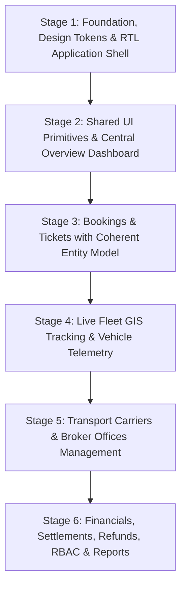

# ZoolGo Central Administration Dashboard — Staged Implementation Plan

## 1. Phasing Strategy & Quality Gates

The implementation is structured into **six manageable stages**. Each stage has a clear scope, explicit dependencies, and demonstrable completion checks. Progression to the next stage occurs only when the current stage meets all quality gates.

---

## 2. Stage Breakdown & Deliverables

### Stage 1: Foundation, Design Tokens, Fonts & Shared Application Shell
* **Objective**: Establish the React + TypeScript frontend codebase, configure canonical design tokens, load Arabic typography, enforce native RTL layout, and deliver the persistent application framing shell.
* **Target Directory**: `zool-go-dashpoard` (or root as designated).
* **Key Tasks**:
  1. Initialize Vite project with React 18/19 and TypeScript.
  2. Install core runtime dependencies: `react-router-dom`, `clsx`, `tailwind-merge`, and `@radix-ui/react-slot`.
  3. Configure `tailwind.config.js` with canonical tokens from `DESIGN.md` (Ruby Burgundy `#8E1B32`, Emerald `#0E5C3E`, Mint Canvas `#EBF4F0`, radii, custom shadow elevations).
  4. Inject Google Fonts (`IBM Plex Sans Arabic` & `Material Symbols Outlined`) in `index.html`.
  5. Enforce native RTL baseline layout: `<html dir="rtl" lang="ar">` with tailored Arabic line-heights.
  6. Implement the shared application shell:
     * `Sidebar.tsx`: Persistent 260px right-hand navigation bar, brand header with pulse live badge, 3 domain route groups (Operations, Finance, System Admin), and admin user footer.
     * `Topbar.tsx`: Search bar, operational status indicator (`الأنظمة التشغيلية: متصلة 100%`), date badge, quick-action trigger, notification bell, admin profile avatar.
     * `Breadcrumbs.tsx`: Contextual path generator with RTL chevron separators.
     * `AppShell.tsx`: Responsive layout wrapping the sidebar, topbar, and main content canvas.
  7. Register dummy route placeholders for all 10 domain modules so every navigation link in the sidebar is active and navigable.
* **Completion Checks**:
  * [x] Development server boots instantly (`npm run dev`) with zero console warnings.
  * [x] Sidebar renders on the right side of the screen with proper Arabic typography and icons.
  * [x] All navigation links smoothly switch route views without full page reloads.
  * [x] Visual appearance of the shell matches `overview_dashboard/screen.png` and `3_navigation_data_tables/screen.png`.

---

### Stage 2: Shared UI Components & Overview Dashboard (COMPLETED)
* **Objective**: Build reusable atomic and compound UI components, followed by the complete multi-state Executive Overview Dashboard.
* **Key Tasks**:
  1. Create atomic UI components in `src/components/ui/`:
     * `Button`: Primary Burgundy, Brand Outline, Ghost, Danger variants.
     * `Input` & `Select`: Form controls with right-aligned labels and emerald focus rings.
     * `Badge`: Status badge matrix (`Confirmed`, `Pending`, `Cancelled`, `Scheduled`).
     * `Card`: Standard white surface card with `#D5E2DC` boundary and elevation shadows.
     * `MetricCard`: KPI card with title, tabular figure, subtext, and trend pill.
     * `HeroBalanceCard`: Deep emerald background (`#0E5C3E`) balance summary card.
     * `Modal` & `Drawer`: Radix UI Dialog wrapper with blurred backdrop.
     * `Table`: High-density table primitives with `tabular-nums` support.
     * `Skeleton`: Pulsing loading state primitive.
  2. Implement Executive Overview Dashboard (`/overview`):
     * **Populated State (`overview_dashboard`)**: 4 KPI cards (Balance/GMV, Active Bookings, Active Fleet, Pending Actions), immediate action required callout queue, booking channels breakdown (Direct vs Broker), and recent bookings table.
     * **Empty State (`_9`)**: Zero-data illustration, friendly messaging, and date-range reset CTA.
     * **Loading Skeleton (`_10`)**: Exact pulsing layout mirroring the overview cards and table.
     * **Error State with Diagnostic Modal (`_11`)**: Connection failure banner and technical diagnostic modal with manual retry CTA.
  3. Provide an interactive state switcher on the overview page to easily preview all 4 states.
* **Completion Checks**:
  * [x] UI primitives match `1_foundations`, `2_buttons_form_controls`, and `4_cards_feedback`.
  * [x] Overview dashboard matches `overview_dashboard/screen.png`.
  * [x] Empty, skeleton, and error variants match `_9`, `_10`, and `_11` pixel-for-pixel.
  * [x] Quick actions and date filter buttons are interactive.

---

### Stage 3: Bookings & Tickets Module with Coherent Mock Data (COMPLETED)
* **Objective**: Implement the universal bookings datagrid, the contrasting customer vs broker booking details, and the complete audit trail.
* **Key Tasks**:
  1. Construct central mock data fixtures ensuring shared entity keys (`TRIP-983`, `ZL-854921`, `ZL-BR-19482`).
  2. Implement **Bookings & Tickets List (`/bookings` - `_5`)**:
     * High-density table with reference ID, passenger name, carrier, route, departure date/time, channel tag (مكتب وسيط vs مسافر مباشر), payment badge, and actions.
     * Filter toolbar: Reference search, status dropdown, carrier filter, date range presets, and explicit date filter target toggle (`booking_created` vs `trip_departure`).
     * Export currently filtered records to a correctly escaped UTF-8 CSV with BOM.
  3. Implement **Customer Direct Booking Detail (`/bookings/:id` - `_6`)**:
     * Trip summary (#TRIP-983), seat A12, passenger contact vs buyer account, Sadad/Bankak payment record, digital ticket preview, print-to-PDF trigger, and operational alert diagnostics for carrier sync failure.
  4. Implement **Broker Office Booking Detail (`/bookings/:id` - `_7`)**:
     * **Explicit Financial Separation Hero**: 6 financial cards showing Ticket Face Value vs Wallet Debit (-350) vs Historical Balance after debit (15,150) vs Current Balance (84,200) vs Accumulated Commission (+35, #W-44).
     * Broker office credentials (*وكالة النيل للسفر - AG-882*), executing clerk (*مروان الكاتب*), POS terminal, traveler info, and print/preview dispatch.
  5. Implement **Booking Audit Trail (`/bookings/:id/activity` - `_8`)**:
     * Chronological lifecycle timeline and linked read-only financial ledger entries with settlement matrix.
  6. Direct navigation to Live Fleet Tracking (`/tracking?busId=...`) with assigned bus (`ZG-BUS-018`) and helpful fallback explanation when vehicle is unassigned.
* **Completion Checks**:
  * [x] Bookings table renders accurately with instant search, multi-facet filtering, sorting, pagination, and UTF-8 CSV export.
  * [x] Direct booking (`ZL-854921`) and Broker booking (`ZL-BR-19482`) display their respective domain layouts sharing a reusable shell.
  * [x] Financial separation figures in the broker view match business rules (Wallet Debit = Ticket Price, Commission logged separately, historical post-debit balance distinguished from current balance).
  * [x] Audit log and ledger table display coherent timestamped milestones and accounting entries.
  * [x] Per-passenger digital ticket preview generates real demo QR code (`QRCodeSVG`) with accurate print/PDF layout.
  * [x] Multi-passenger seats (`ZL-854925`), pending payment (`ZL-854930`), and cancelled/refunded booking (`ZL-902144`) are fully supported.
  * [x] Unit test suite (vitest) and production build pass with 100% green status.

---

### Stage 4: Live Fleet GIS Tracking & Vehicle Telemetry (COMPLETED)
* **Objective**: Deliver the real interactive Sudan GIS corridor map using OpenStreetMap and Leaflet, live telemetry simulation, selected bus inspector drawer, and the full vehicle details page.
* **Key Tasks**:
  1. Integrate Leaflet and React Leaflet with configurable OpenStreetMap tiles (`https://tile.openstreetmap.org/{z}/{x}/{y}.png`) and visible linked attribution.
  2. Implement **Live Fleet Tracking Page (`/tracking` - `_12` & `_13`)**:
     * Real geographic road network polylines for Sudan transit corridors (Sharyan Al-Shamal, Challenge Highway to Port Sudan, Eastern Kassala Highway, Western Kosti Highway).
     * Top-down SVG bus markers rotated to match actual travel heading with upright text labels and distinct status colors (moving, stopped, delayed, GPS disconnected).
     * Compact operational KPI header (Monitored, Active on route, Stopped, Delayed, Operational alerts, GPS disconnected) and simulation controls (pause/resume, 1x/5x/15x speed).
     * Floating search and filter toolbar (Bus ID, plate, carrier, corridor, operational status, GPS status).
     * Interactive map controls (Zoom in/out, fit all visible buses, fullscreen toggle, follow bus mode with manual pan yield and resume action).
     * Color-coded status map legend matching Stitch `_12.png`.
     * Bottom corridor summary strip (cellular coverage, 0 emergency alerts, 96.4% on-time discipline, approved rest stops).
  3. Implement **Selected-Bus Details Drawer on Map (`VehicleDetailsDrawer.tsx` - `_13` & `zg_bus_018`)**:
     * Slide-over drawer on map with verified badge, carrier, 4G hardware status, speed, compass heading, precise road location, distance progress bar, trip summary, and action triggers.
  4. Implement **Full Bus & Current-Trip Details Page (`/tracking/vehicles/:vehicleId` - `zg_bus_018`)**:
     * Direct URL access with breadcrumbs and back navigation preserving map context.
     * 5 working tabs:
       * **نظرة عامة (Overview)**: Interactive corridor Leaflet map + live diagnostics gauge + summary cards (vehicle specs, trip schedule, seat occupancy).
       * **الرحلة الحالية (Current Trip)**: Stops sequence timeline with actual vs scheduled arrivals and passenger boardings.
       * **سجل التتبع اللحظي (Telemetry Log)**: Detailed ping history table with exportable CSV.
       * **بيانات الحافلة والمواصفات (Bus Specs)**: Comprehensive technical dossier and maintenance schedule.
       * **التنبيهات التشغيلية (Alerts)**: Incident and delay tracking records.
  5. Implemented development telemetry simulator service (`telemetrySimulator.ts`) with subscription interface, distance-based interpolation, and clean unmount lifecycle.
* **Completion Checks**:
  * [x] Interactive OpenStreetMap renders correctly in RTL layout with linked attribution.
  * [x] SVG bus markers visibly animate along highway routes with correct travel orientation.
  * [x] Selecting a vehicle highlights the route polyline, activates follow mode, and opens the details drawer.
  * [x] All 5 tabs on `/tracking/vehicles/:vehicleId` display meaningful data matching the design system.
  * [x] Filter toolbar updates visible vehicles and metrics dynamically.
  * [x] Production build (`npm run build`) and unit tests (`npm run test`) pass with zero errors.

---

### Stage 5: Transport Companies & Broker Offices Modules (COMPLETED)
* **Objective**: Implement administrative governance over carriers and licensed broker agencies.
* **Key Tasks**:
  1. Implement **Transport Companies Module (`/companies`)**:
     * Carrier list page with corridor activity and "Add Carrier" modal dialog (`_1`).
     * Carrier detail tab 1: Overview & Contact Profile (`_2`).
     * Carrier detail tab 2: Corridor Routes, Schedule & Fleet (`_3`).
     * Carrier detail tab 3: Assigned Brokers & Commission Rate Governance (`_4`) with "Assign Broker" modal.
  2. Implement **Broker Offices Module (`/brokers`)**:
     * Agency list page with wallet balance indicators, low-balance alert cards/banner, and "Add Agency" modal (`_14`).
     * Broker detail tab 1: Agency Accreditation & POS Status (`_15`) with wallet top-up modal.
     * Broker detail tab 2: Assigned Carriers & Staff Permissions Directory (`_16`).
     * Broker detail tab 3: Pre-paid Wallet Ledger & Commission History (`_17`) with instant top-up drawer.
  3. Implement cross-entity linking: Navigating from a carrier's assigned broker leads directly to that broker's profile, and vice versa; and bus fleet items link directly to `/tracking?busId=...`.
* **Completion Checks**:
  * [x] All 6 carrier and broker detail tabs render their exact Stitch layouts.
  * [x] Modals for adding companies, assigning brokers, and crediting wallets open and mutate mock state cleanly.
  * [x] Strict Super Admin assignment logic and financial separation rules are visually respected.
  * [x] 100% clean TypeScript compile (`npx tsc -b`) and 34/34 passing Vitest tests.

---

### Stage 6: Financials, Settlements, Refunds, RBAC & Reports
* **Objective**: Complete remaining enterprise modules subject to confirmed requirements.
* **Key Tasks**:
  1. Implement **Financials & Settlements (`/financials/*`)**:
     * Cash liquidity overview (`_22`) and general journal ledger (`_23`).
     * Bank transfer verification queue (`_24`) with receipt inspection drawer.
     * Double-entry ledger entry detail (`_25`).
     * Financial analytics charts (`_26`), trial balance parity report (`_27`), and carrier revenue shares (`_28`).
  2. Implement **Cancellations & Refunds (`/refunds/*`)**:
     * Refund queue with instant exception drawer (`_34`) and decision modal (`_36`).
     * Refund policy rules engine (`_35`).
     * Dispute resolution workspace for ticket #ZL-902144 (`_37`).
  3. Implement **System Administration & Governance (`/admin/*`)**:
     * Admin team list (`_30`) and supervisor profile with session revoke (`_31`).
     * RBAC governance matrix (`_32`) and role builder drawer (`_33`).
  4. Implement **Passenger Accounts (`/travelers/*`)**:
     * Travelers directory (`_18`), trip history map (`_19`), security sessions (`_20`), and identity verification (`_21`).
  5. Implement **Export Center (`/reports` - `_29`)**:
     * Periodic report generation and download triggers.
* **Completion Checks**:
  * [ ] All 39 Stitch screen mockups and state variants are fully implemented.
  * [ ] Bank slip approval triggers wallet balance increase.
  * [ ] Refund adjudication updates booking status and ledger entry.
  * [ ] Zero TypeScript errors across the entire codebase.

---

## 3. Immediate Focus: Stage 1 Execution Deliverables

When implementation begins, Stage 1 will deliver:
1. Standalone Vite + React + TypeScript application workspace.
2. Tailwind CSS configuration with exact color tokens from `DESIGN.md`.
3. Typography integration for `IBM Plex Sans Arabic` and `Material Symbols Outlined`.
4. The complete application shell (`AppShell`, `Sidebar`, `Topbar`, `Breadcrumbs`) with active route switching.
5. All 10 module route stubs with placeholder breadcrumb headers ready for component drop-in.

---

## Related (backend gap audit, 2026-10-23)

The dashboard remains mock-driven. Do not treat this frontend plan as backend authority.

- [`ADMIN_DASHBOARD_BACKEND_GAP_AUDIT.md`](ADMIN_DASHBOARD_BACKEND_GAP_AUDIT.md)
- [`ADMIN_DASHBOARD_ROUTE_AND_ACTION_MATRIX.md`](ADMIN_DASHBOARD_ROUTE_AND_ACTION_MATRIX.md)
- [`ADMIN_DASHBOARD_API_REQUIREMENTS.md`](ADMIN_DASHBOARD_API_REQUIREMENTS.md)
- [`ADMIN_BACKEND_COMPLETION_ROADMAP.md`](ADMIN_BACKEND_COMPLETION_ROADMAP.md)
