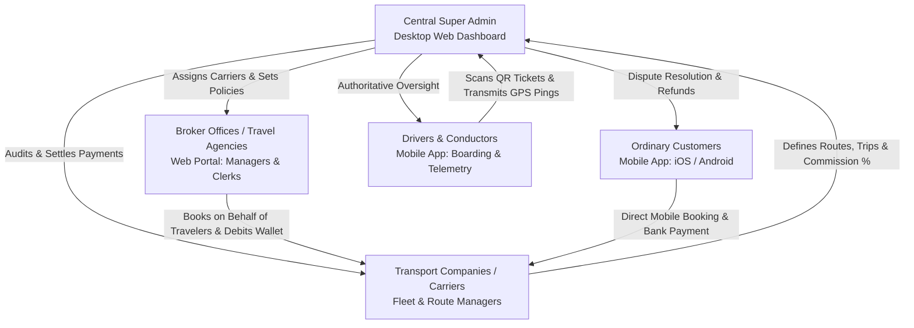
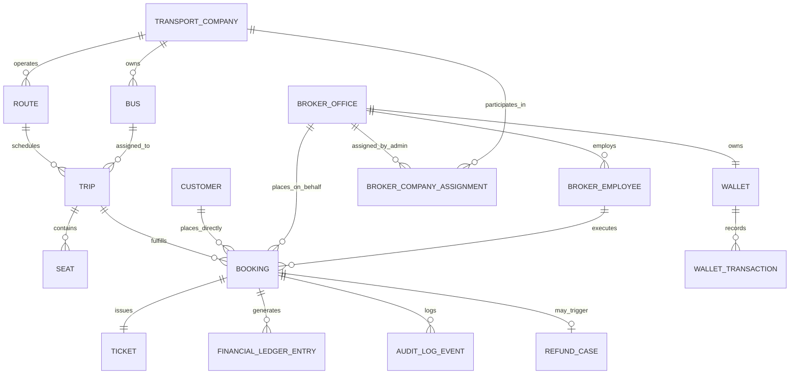

# ZoolGo Central Administration Dashboard — Project Brief

## 1. Executive Summary & Product Vision

**ZoolGo (زولغو)** is an integrated intercity transport booking and transit dispatch platform designed for the Sudanese transportation ecosystem. The platform connects passengers, transport carriers, licensed travel brokers, drivers, and central platform operators to digitize intercity bus travel across major transit corridors in Sudan (e.g., Khartoum, Shendi, Begrawiya, Merowe, Port Sudan, and Kosti).

The platform addresses long-standing challenges in the regional transport market: paper-based ticketing, fragmented broker commissions, lack of real-time bus tracking, cash handling risks, and absence of standardized audit trails.

The **Central Administration Dashboard (لوحة الإدارة المركزية - Super Admin)** is the administrative nerve center of ZoolGo. It gives central platform operators authoritative oversight over fleet operations, financial liquidity, broker wallet accounts, carrier commission assignments, dispute resolutions, and platform governance.

---

## 2. Product Actors & Roles

Understanding the platform requires distinguishing five distinct actors and their respective operational touchpoints:

### 1. Central Platform Administrators (المشرف العام وفريق الإدارة)
* **Scope**: Operators of the central desktop dashboard.
* **Responsibilities**:
  * Governing transport company accreditations and active corridor routes.
  * Explicitly assigning transport companies to broker offices.
  * Approving broker wallet top-up requests (verifying bank transfer receipts).
  * Executing manual commission settlement payouts to brokers and revenue share settlements to transport companies.
  * Monitoring live fleet movements, corridor health, and telemetry warnings.
  * Adjudicating cancellation and refund disputes.
  * Enforcing Role-Based Access Control (RBAC) and security audits.

### 2. Broker Offices & Clerks (مكاتب الوكلاء المعتمدة وموظفو الحجز)
* **Scope**: Licensed travel agencies operating via a dedicated web panel.
* **Characteristics**:
  * Operates as an agency entity with multiple clerk/employee logins under a parent account.
  * Funded via a **pre-paid digital wallet (محفظة مسبقة الدفع)** that is debited automatically upon each booking.
  * Can **only** see and book trips for transport companies explicitly assigned to them by the Super Admin.
  * Books on behalf of third-party travelers (manually entering traveler identity and contact information).
  * Earns a carrier-specific commission percentage that accumulates per booking.
  * Dispatches tickets to travelers via WhatsApp, PDF download, or physical thermal printing (since end travelers often lack the ZoolGo app).

### 3. Transport Companies / Carriers (شركات النقل البري)
* **Scope**: Intercity bus fleet operators (e.g., *شركة النيل للنقل البري*, *شركة التاج*, *شركة شريان الشمال*).
* **Characteristics**:
  * Maintain fleet inventories (buses, plate numbers, capacities, telemetry hardware).
  * Schedule daily and seasonal trips across intercity corridors.
  * Set individual commission percentages offered to brokers.
  * Receive periodic revenue settlements from the platform after deductions.

### 4. Ordinary Customers (المسافرون الأفراد)
* **Scope**: End consumers booking directly via the ZoolGo mobile application.
* **Characteristics**:
  * Authenticate via mobile number + OTP.
  * Search and view all active platform carriers without restriction.
  * Pay directly via integrated electronic banking gateways (primarily **Bankak - بنك الخرطوم**).
  * Receive and present digital QR tickets inside the mobile app.
  * In case of cancellation/refund, funds return directly to the customer's payment method.

### 5. Drivers & Vehicle Conductors (السائقون ومشرفو الرحلات)
* **Scope**: Onboard crew operating the driver mobile application.
* **Characteristics**:
  * View assigned trip manifests and live passenger boarding checklists.
  * Scan passenger digital QR tickets at boarding gates (`PassengerBoarding.png`, `QRScanner.png`).
  * Stream live vehicle telemetry (GPS coordinates, speed, route progress) via onboard IoT units (e.g., Teltonika) or driver phone GPS.

---

## 3. Implementation Scope: Central Administration Dashboard

The central dashboard is a high-density, RTL-first desktop web application designed for operations, finance, and system administrators.

### Core Modules within Scope:

1. **Executive Overview Dashboard (نظرة عامة)**:
   * Real-time operational metrics (active trips, onboard passengers, daily GMV, wallet liquidity float).
   * High-priority action queues (pending bank verifications, urgent cancellation requests, off-track buses).
   * Booking volume distribution by channel (Direct Customer vs Broker Office).
   * Empty, loading skeleton, and system error diagnostic state variants.

2. **Bookings & Tickets (الحجوزات والتذاكر)**:
   * Universal search and filtering by reference ID, date range, carrier, channel, and payment status.
   * **Direct Customer Booking Detail**: Trip itinerary, seat allocation, digital ticket status, passenger details, Bankak payment record.
   * **Broker Office Booking Detail**: Explicit financial separation showing ticket face value, broker wallet debit, accumulated commission, remaining broker balance, booking clerk ID, and passenger delivery channel.
   * **Booking Audit Log**: Chronological lifecycle trace and double-entry ledger references.

3. **Transport Companies (شركات النقل)**:
   * Carrier registry, licensing status, operational corridors, and fleet size.
   * Carrier profile with active trips, route stops, and GPS-tagged bus fleet.
   * Broker assignment matrix and carrier-specific broker commission rate governance.

4. **Broker Offices (مكاتب الوكلاء)**:
   * Agency registry, licensing details, current wallet balance, and low-balance warnings.
   * Pre-paid wallet ledger (all top-up credits and booking debits with linked references).
   * Assigned transport companies list with applicable commission percentages.
   * Agency staff directory with role permissions (booking-only vs booking + top-up + reports).

5. **Live Fleet Tracking (التتبع المباشر للأسطول)**:
   * Interactive Sudan GIS corridor map (Khartoum – Shendi – Begrawiya – Merowe corridor).
   * Fleet status list with search, route filters, and speed/delay indicators.
   * Bus telemetry slide-over drawer (speed, passenger occupancy, stop timeline, telemetry pings).

6. **Financials & Settlements (المالية والتسويات)**:
   * Platform cash liquidity and broker wallet float oversight.
   * General financial ledger (double-entry accounting breakdown).
   * Wallet top-up requests queue: verifying bank transfer receipts and approving instant balance credits.
   * Transport company revenue share reports and settlement cycle notifications.

7. **Cancellations & Refunds (الإلغاءات والاسترداد)**:
   * Refund request queue with urgency indicators.
   * Incident investigation and dispute resolution workspace.
   * Cancellation policy rules engine (retention/penalty tiers based on cancellation time).
   * Immediate exceptional refund execution with ledger adjustments.

8. **System Administration & Governance (إدارة النظام والصلاحيات)**:
   * Administrator accounts and session management.
   * Role-Based Access Control (RBAC) governance matrix and permission builder.
   * System security audit log.

9. **Reports & Scheduled Disclosures (التقارير المالية والإحصاءات)**:
   * Periodic disclosure center (daily cash flow, weekly broker commissions, monthly trial balance).
   * Custom export scheduler (PDF, Excel, CSV).

---

## 4. Confirmed Relationships & Entity Model

The following entity relationship diagram illustrates how the core business domain entities link together:

### Key Relational Constraints:
1. **Strict Carrier Assignment**: A Broker Office can **only** book trips belonging to a `TRANSPORT_COMPANY` where an active `BROKER_COMPANY_ASSIGNMENT` exists.
2. **Dual Booking Channels**: Every `BOOKING` originates from either a direct `CUSTOMER` (with bank transaction) or a `BROKER_OFFICE` + `BROKER_EMPLOYEE` (with wallet deduction).
3. **Financial Separation**: A broker booking records two distinct amounts:
   * `wallet_debit = ticket_price` (deducted immediately from agency wallet).
   * `accumulated_commission = ticket_price * commission_rate` (logged as payable, settled manually later).
4. **Single Source of Truth for Travel**: Both booking types resolve to the same underlying `TRIP`, `BUS`, and `SEAT` inventory.

---

## 5. Regional Context: Sudan Intercity Transit Market

A critical finding from reviewing the source materials (`ZoolGo_Broker_Journey.pdf` Section 8) is the market localization:

| Aspect | Platform Target (Sudan) | Notes / Source Discrepancies |
| :--- | :--- | :--- |
| **Currency** | Sudanese Pound (`ج.س` / SDG) | Some Stitch screens display `ج.س`, while early mockups used Saudi Riyal (`ر.س`). SDG is canonical. |
| **Payment Gateway** | **Bankak (بنكك - بنك الخرطوم)** | Prominently used in Sudan for mobile banking and direct transfers. |
| **Primary Transit Corridors** | Khartoum – Shendi – Merowe / Port Sudan / Kosti | Corridors verified against mobile tracking screens and live GIS Stitch files. |
| **Phone Formatting** | Sudanese mobile format (`+249 9...`, `+249 1...`) | Mobile customer mockups showed temporary `+966` templates; dashboard uses `+249`. |
| **Offline Reality** | WhatsApp / PDF / Print ticket delivery | Passengers booked via brokers often lack smartphones or stable data; physical/PDF slips are mandatory. |
