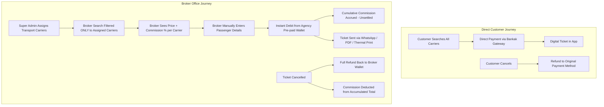

# ZoolGo Central Administration Dashboard — Requirements, Evidence & Decision Register

## 1. Grounding Principles & Source Separation

To ensure documentation integrity, this document strictly differentiates between:
1. **Explicit Business Requirements**: Grounded directly in `ZoolGo_Broker_Journey.pdf` (signed-off business rules).
2. **Observed System Behaviors**: Derived from the original mobile application screens (`Zool/*.png`).
3. **Proposed Administrative Features**: Extracted from the Stitch dashboard mockups (`stitch_zoolgo_admin_design_system/`).
4. **Open Decisions & Policy Conflicts**: Explicitly identified ambiguities with an evaluation of whether each blocks frontend development.

---

## 2. Confirmed Business Requirements (Source: `ZoolGo_Broker_Journey.pdf`)

The document *"زولغو — رحلة حجز الوسيط (ZoolGo - Broker Booking Journey)"* sets authoritative operational rules for the platform:

| Domain | Business Rule / Logic | Source Citation |
| :--- | :--- | :--- |
| **Account Structure** | Broker accounts are **agencies/offices (مكتب/وكالة)** with multi-employee sub-accounts, not individual consumers. | `ZoolGo_Broker_Journey.pdf` §2, §6 |
| **Carrier Assignment** | Assignment of transport carriers to brokers is **100% controlled by the Central Super Admin**. A broker only sees and books for assigned carriers. | `ZoolGo_Broker_Journey.pdf` §2, §6 |
| **Carrier Commission** | Each transport company sets its own specific commission percentage for brokers (rates vary between carriers). | `ZoolGo_Broker_Journey.pdf` §2, §6 |
| **Search & Pricing** | Broker search results display the ticket price **plus** the broker's specific commission percentage for each carrier. | `ZoolGo_Broker_Journey.pdf` §2, §3.4 |
| **Seat Hold Lock** | A 15-minute temporary seat hold lock applies during booking. Can be skipped in favor of auto-assignment. If seat lock expires before payment, user is returned to seat map. | `ZoolGo_Broker_Journey.pdf` §2, §3.6 |
| **Passenger Details** | Broker clerk manually enters traveler's name, mobile number, and national ID/passport (traveler is a different person from the broker). | `ZoolGo_Broker_Journey.pdf` §2, §3.8 |
| **Payment Mechanism** | Booking amount is debited **instantly and directly from the agency pre-paid wallet** (no external bank gateway at checkout). | `ZoolGo_Broker_Journey.pdf` §2, §6 |
| **Insufficient Balance** | If wallet balance is insufficient, checkout is blocked and the user is redirected to the wallet top-up flow. | `ZoolGo_Broker_Journey.pdf` §3.10, §5 |
| **Commission Accrual** | Commissions are **cumulative**—increasing with each confirmed booking and automatically deducted if a booking is cancelled. | `ZoolGo_Broker_Journey.pdf` §6 |
| **Commission Payout** | Commission disbursement is **manual by central administration**, not automated by software. | `ZoolGo_Broker_Journey.pdf` §6 |
| **Settlement Cycles** | Periodic settlements (weekly or monthly) record the last settlement date per broker. | `ZoolGo_Broker_Journey.pdf` §6 |
| **Maximum Booking Limit** | System enforces a ceiling to prevent a broker from exceeding an authorized booking volume or financial exposure limit. | `ZoolGo_Broker_Journey.pdf` §5, §6 |
| **Ticket Dispatch** | Issued in the passenger's name and dispatched via WhatsApp, PDF download, or print (since passengers rarely possess the mobile app). | `ZoolGo_Broker_Journey.pdf` §2, §3.11, §4 |
| **Cancellation & Refund** | When a broker booking is cancelled, refunded funds return to the **broker agency wallet** (since the agency paid). For direct customer bookings, funds return to customer payment method. | `ZoolGo_Broker_Journey.pdf` §2 |

---

## 3. Observed Mobile Behaviors (Source: `Zool/*.png`)

Screenshots from the production mobile applications provide evidence for downstream operational interfaces:

| Mobile Screen | Observed Behavior & Integration Evidence | Dashboard Corroboration |
| :--- | :--- | :--- |
| `PassengerBoarding.png` | Shows conductor's live manifest for trip **الخرطوم ← مروي**: 12 of 18 passengers boarded. Passenger names, seat numbers (12A, 12B, 14A), and binary boarding status (`صعد الباص` vs `في الانتظار`). | Reflected in Admin Trip Details (`_3`) and Bus Telemetry Drawer (`zg_bus_018`). |
| `QRScanner.png` | Conductor camera scanning a digital ticket with barcode and reference code **ZL-854921**, seat A12, VIP class, East Delta / Nile carrier. | Matches the exact sample booking reference in Stitch `_6` (`تفاصيل الحجز ZL-854921`). |
| `TripDetailsScreen.png` | Comprehensive itinerary for **رقم الرحلة #983** along the corridor: 09:00 Khartoum → 12:00 Shendi → 13:30 Begrawiya → 14:30 Merowe. Carrier: *شركة النيل للنقل*, Driver: *أحمد محمد سليمان*, Plate: *خ ر ط 1234*. | Direct match for Stitch `_3`, `_6`, `_7`, `_8`, `_13`, and `zg_bus_018`. |
| `Map.png` | Shows active transit route with intermediate rest stops (Shendi / Wadi Al-Natrun placeholder), remaining distance (82 km), and ETA. | Corroborates the live telemetry simulation in `_12` and `_13`. |

---

## 4. Proposed Dashboard Features (Source: Stitch Mockups)

The Stitch export introduced several advanced enterprise features that must be treated as **proposals** rather than binding contractual business logic:

1. **Double-Entry General Ledger (`_23`, `_25`, `_27`)**:
   * *Proposed*: Full accounting system with debit/credit legs, ledger journals, trial balance parity checks, and chart of accounts.
   * *Status*: Excellent visual presentation for a financial dashboard; will be backed by a clean mock accounting ledger without enforcing complex ERP rules.
2. **Cancellation & Refund Policy Engine (`_35`)**:
   * *Proposed*: Configurable tiered refund matrix (Early cancellation: 90% refund, Mid: 70%, Critical: 50%, No-show: 0%) plus carrier mechanical breakdown compensation rules.
   * *Status*: UI will be interactive and configurable in mock state, but underlying policy formulas are treated as proposals.
3. **Multi-Role RBAC Governance Matrix (`_32`, `_33`)**:
   * *Proposed*: Five distinct administrative roles (Super Admin, Financial Auditor, Fleet Manager, Support Agent, Compliance Officer) with strict Separation of Duties (SoD) policies.
   * *Status*: Implemented in mock mode; does not block Stage 1.
4. **Sudan Live GIS Telemetry Canvas (`_12`, `_13`, `zg_bus_018`)**:
   * *Proposed*: 10-second automatic ping refresh from Teltonika IoT vehicle tracking units.
   * *Status*: Visual SVG-based corridor tracking with mock interval updates; no external paid map API required.
5. **Bank Transfer Verification Queue (`_24`)**:
   * *Proposed*: Manual review queue for Bankak transfer receipts with side-by-side verification before wallet balance credit.
   * *Status*: Retained as a core workflow; administrative approval triggers wallet balance update.

---

## 5. Conflict & Ambiguity Register

The following table records all identified discrepancies, ambiguities, and open decisions, stating explicitly whether each item blocks Stage 1 implementation:

| Issue / Conflict | Conflicting Sources | Analysis & Practical Resolution | Blocks Stage 1? |
| :--- | :--- | :--- | :--- |
| **Regional Data Localization** | Mobile customer app used temporary Saudi data (`+966`, SAPTCO, Riyadh/Jeddah); Driver app and Stitch use Sudan data (`+249`, Khartoum/Shendi/Merowe, SDG). | `ZoolGo_Broker_Journey.pdf` §8 explicitly notes this discrepancy and confirms Sudan is the real target market. **Resolution**: Canonical currency is Sudanese Pound (`ج.س` / SDG), phone format is `+249`, and corridors are Sudanese. | **NO**. Clear consensus to standardize on Sudan data. |
| **Minimum Top-up Threshold** | `ZoolGo_Broker_Journey.pdf` §7 marks as open: *"Is minimum top-up fixed system-wide or customizable per broker?"* | Stitch screens display sample top-ups of 50,000 ج.س. **Resolution**: Support both a global default (e.g. 50,000 ج.س) and an optional broker-level override field. | **NO**. Handled via mock state. |
| **Maximum Booking Ceiling** | `ZoolGo_Broker_Journey.pdf` §7 marks as open: *"Is booking limit fixed system-wide or customizable per broker?"* | Stitch `_15` displays agency float limits. **Resolution**: Implement as an optional limit field in the broker profile mock data. | **NO**. Does not block foundation. |
| **Settlement Periodicity** | `ZoolGo_Broker_Journey.pdf` §7 marks as open: *"Is settlement periodicity (weekly vs monthly) global or customizable per broker?"* | Stitch `_7` displays: `دورة التسوية النشطة: الأسبوع 44 (2024)` (Weekly). **Resolution**: Default to weekly settlement cycles with an option to select monthly in broker settings. | **NO**. Does not block foundation. |
| **Cancellation Retention Percentages** | Stitch `_35` defines specific timed tiers (90%, 70%, 50%); `ZoolGo_Broker_Journey.pdf` §2 only states that refunded funds return to broker wallet without specifying deduction tiers. | Stitch policy engine provides a rich UI. **Resolution**: Present the policy matrix as a configurable administrative tool without hardcoding immutable business formulas. | **NO**. Part of Stage 6. |
| **Commission Payout Flow** | `ZoolGo_Broker_Journey.pdf` §6 stipulates: *"Commission payout is manual by administration, not automatic."* Stitch `_28` shows settlement notices. | **Resolution**: The dashboard will feature a manual "Settle Commission (صرف / تسوية العمولة)" action button that generates a settlement payout record and resets the broker's unsettled commission counter. | **NO**. Part of Stage 5 & 6. |
| **Accounting Depth (ERP vs Ledger)** | Stitch `_23`, `_25`, `_27` present double-entry bookkeeping; `ZoolGo_Broker_Journey.pdf` focuses on broker wallet balance and accumulated commission. | **Resolution**: Provide a coherent single-source mock financial service that automatically generates balanced journal entries when bookings or wallet top-ups occur. | **NO**. Part of Stage 6. |

---

## 6. Genuine Blockers for Stage 1

> [!IMPORTANT]
> **Summary of Stage 1 Blockers:**
> Are there any architectural or business ambiguities that prevent scaffolding the project foundation, configuring design tokens, setting up the font and RTL system, and building the shared application shell?
> 
> **Answer: NONE.**
> * The brand identity, color tokens (`#8E1B32`, `#0E5C3E`, `#EBF4F0`), typography (`IBM Plex Sans Arabic`), and layout structure (260px right sidebar, persistent top bar) are 100% defined in `DESIGN.md` and verified across all 45 folders.
> * The canonical routes and entity identifiers are fully mapped.
> * Stage 1 delivers the shared shell, navigation, and theme foundations, which are completely independent of open financial policy values.
