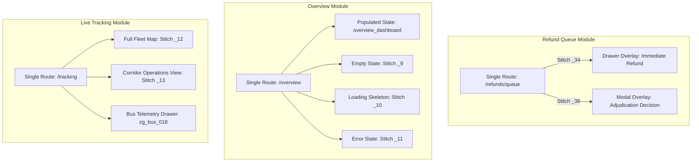

# ZoolGo Central Administration Dashboard — Screen Inventory & Stitch Analysis

## 1. Overview & Source Breakdown

The workspace provides **45 folders** in `stitch_zoolgo_admin_design_system/stitch_zoolgo_admin_design_system/`:
* **1 Design Specification**: `emerald_crimson_transit_admin/DESIGN.md` defining the brand tokens, typography, colors, and layout guidelines.
* **5 UI Kit Reference Suites**: Foundational atomic components, form controls, tables, navigation, cards, feedback, dialogs, and slide-overs (`1_foundations` to `5_dialogs_drawers_shared_patterns`).
* **39 Interactive Dashboard Screen Mockups**: Representing full pages, contextual drawers, modal dialogs, and loading/error states for the central administrator (`_1` to `_37`, `overview_dashboard`, and `zg_bus_018`).

This inventory systematically documents all screens, identifies duplicates, maps state variants to canonical routes, and highlights missing references.

---

## 2. Complete Screen Catalog

### Module 0: UI Kit & Foundations Reference

| Folder | Screen Name (Arabic / English) | Screenshot & HTML Path | Role & Canonical Route | Component Architecture & Purpose |
| :--- | :--- | :--- | :--- | :--- |
| `1_foundations` | **الأساسيات (Foundations)** | `1_foundations/screen.png` `1_foundations/code.html` | UI Reference `/dev/ui-kit/foundations` | Color tokens (Ruby Burgundy `#8E1B32`, Emerald `#0E5C3E`, Mint `#EBF4F0`), IBM Plex Sans Arabic typography, 4px grid scale, radii, shadows, and RTL text rules. |
| `2_buttons_form_controls` | **الأزرار وحقول الإدخال (Buttons & Form Controls)** | `2_buttons_form_controls/screen.png` `2_buttons_form_controls/code.html` | UI Reference `/dev/ui-kit/forms` | Button matrix (Primary, Brand Outline, Ghost, Danger), text inputs, select dropdowns, search bars, checkbox/radio/switch primitives, and passenger/seat entry form pattern. |
| `3_navigation_data_tables` | **الجداول والتنقل (Navigation & Tables)** | `3_navigation_data_tables/screen.png` `3_navigation_data_tables/code.html` | UI Reference `/dev/ui-kit/tables` | Fixed 260px/288px RTL sidebar, persistent top operational bar, breadcrumb trails, high-density tabular layout with sorting, pagination, and numeric formatting (`tabular-nums`). |
| `4_cards_feedback` | **البطاقات والمؤشرات (Cards & Feedback)** | `4_cards_feedback/screen.png` `4_cards_feedback/code.html` | UI Reference `/dev/ui-kit/feedback` | Metric overview cards, hero balance card (`#0E5C3E`), status badge matrix (Confirmed, Pending, Cancelled), toast notifications, tooltips, spinners, and skeleton placeholders. |
| `5_dialogs_drawers_shared_patterns` | **النوافذ المنبثقة والأدراج (Dialogs & Drawers)** | `5_dialogs_drawers_shared_patterns/screen.png` `5_dialogs_drawers_shared_patterns/code.html` | UI Reference `/dev/ui-kit/overlays` | Standard modal dialogs (manifest confirmation, cancellation alert), slide-over side drawers (trip inspector, manual ticket issuance), and process lifecycle state patterns. |

---

### Module 1: Executive Overview Dashboard

| Folder | Screen Name | Artifact Paths | Proposed Route | Screen Type | Primary Purpose & Key Actions | Related Screens |
| :--- | :--- | :--- | :--- | :--- | :--- | :--- |
| `overview_dashboard` | **نظرة عامة (Overview Dashboard)** | `overview_dashboard/screen.png` `overview_dashboard/code.html` | `/` or `/overview` | **Full Page** | Executive cockpit displaying operational KPIs (active trips, revenue, float), action-required queue, booking channel split (Direct vs Broker), and recent bookings table. Quick actions: Date filter, manual refresh. | `_5`, `_9`, `_10`, `_11`, `_22`, `_24` |
| `_9` | **نظرة عامة — حالة فارغة (Overview Empty State)** | `_9/screen.png` `_9/code.html` | `/overview?state=empty` | **State Variant** | Displayed when no bookings or operational events occur within the selected date range. Offers CTA to reset date range or select last 30 days. | `overview_dashboard` |
| `_10` | **نظرة عامة — حالة التحميل (Overview Skeleton State)** | `_10/screen.png` `_10/code.html` | `/overview` (during fetch) | **State Variant** | Animated pulse skeleton state replicating card shapes and table rows while asynchronous data loads from the backend or mock service. | `overview_dashboard` |
| `_11` | **نظرة عامة — تعذر التحميل (Overview Error State)** | `_11/screen.png` `_11/code.html` | `/overview` (on error) | **State Variant + Modal** | Displayed upon backend failure or network loss. Features diagnostic error summary modal and manual retry button. | `overview_dashboard` |

---

### Module 2: Transport Companies (Carriers)

| Folder | Screen Name | Artifact Paths | Proposed Route | Screen Type | Primary Purpose & Key Actions | Related Screens |
| :--- | :--- | :--- | :--- | :--- | :--- | :--- |
| `_1` | **شركات النقل (Transport Companies List)** | `_1/screen.png` `_1/code.html` | `/companies` | **Full Page + Modal** | List of all registered intercity carriers with corridor coverage, active fleet counts, and verification badges. Includes modal dialog: "إضافة شركة نقل جديدة (Add New Carrier)". Actions: Filter, Export CSV, Add Company. | `_2`, `_3`, `_4` |
| `_2` | **تفاصيل شركة النقل — نظرة عامة (Company Detail: Overview)** | `_2/screen.png` `_2/code.html` | `/companies/:id` (Tab: Overview) | **Full Page + Drawer** | Carrier profile, commercial licensing, contact persons, broker relationship summary, fleet geo-distribution map snapshot. Slide-over drawer: Quick actions and edit contact profile. | `_1`, `_3`, `_4`, `_12` |
| `_3` | **تفاصيل شركة النقل — المسارات والأسطول (Company Detail: Routes & Fleet)** | `_3/screen.png` `_3/code.html` | `/companies/:id` (Tab: Routes & Fleet) | **Full Page** | Authorized corridor routes, approved terminal stops, today's departure schedule, and live fleet status list with GPS hardware indicators. | `_2`, `_4`, `_12`, `zg_bus_018` |
| `_4` | **تفاصيل شركة النقل — الوسطاء والعمولات (Company Detail: Brokers & Commissions)** | `_4/screen.png` `_4/code.html` | `/companies/:id` (Tab: Brokers) | **Full Page + Modal** | Carrier's assigned broker agencies, applicable commission percentage per broker, commission change audit log. Includes modal: "ربط مكتب وسيط بشركة النقل (Assign Broker to Carrier)". | `_2`, `_3`, `_14`, `_16` |

---

### Module 3: Bookings & Tickets

| Folder | Screen Name | Artifact Paths | Proposed Route | Screen Type | Primary Purpose & Key Actions | Related Screens |
| :--- | :--- | :--- | :--- | :--- | :--- | :--- |
| `_5` | **الحجوزات والتذاكر (Bookings & Tickets List)** | `_5/screen.png` `_5/code.html` | `/bookings` | **Full Page** | Comprehensive table of all issued bookings across Sudan. Filters by reference, channel (Direct Customer vs Broker), carrier, payment method, and status. Quick date ranges. | `_6`, `_7`, `_8` |
| `_6` | **تفاصيل حجز المسافر المباشر (Customer Booking Detail: ZL-854921)** | `_6/screen.png` `_6/code.html` | `/bookings/:id` (Direct Customer) | **Full Page** | Full detail for direct mobile booking. Shows trip summary (#TRIP-983), passenger details (Mohamed Ahmed), seat A12, Bankak payment slip, digital QR ticket status, PDF voucher download. | `_5`, `_8`, `_18` |
| `_7` | **تفاصيل حجز مكتب الوسيط (Broker Booking Detail: ZL-BR-19482)** | `_7/screen.png` `_7/code.html` | `/bookings/:id` (Broker Booking) | **Full Page** | Dedicated view showing **explicit financial separation**: Ticket Face Value vs Instant Wallet Debit vs Accumulated Commission (#W-44). Identifies Broker Agency (AG-882), booking clerk, delivery channel (WhatsApp/PDF/Print). | `_5`, `_8`, `_15`, `_17` |
| `_8` | **سجل الحجز والتدقيق المالي (Booking Audit Log & Ledger)** | `_8/screen.png` `_8/code.html` | `/bookings/:id/audit` | **Full Page** | Chronological event timeline (Seat Lock -> Wallet Debit -> Ticket Issued -> Boarding Verified) paired with matching double-entry ledger entries. Action: Export PDF audit report. | `_6`, `_7`, `_23`, `_25` |

---

### Module 4: Live Fleet Tracking & Telemetry

| Folder | Screen Name | Artifact Paths | Proposed Route | Screen Type | Primary Purpose & Key Actions | Related Screens |
| :--- | :--- | :--- | :--- | :--- | :--- | :--- |
| `_12` | **التتبع المباشر للأسطول (Live Fleet Tracking)** | `_12/screen.png` `_12/code.html` | `/tracking` | **Full Page + Drawer** | Interactive Sudan GIS tracking map showing all active buses on transit corridors. Includes slide-over drawer: Vehicle search, speed/delay status, and corridor filters. | `_13`, `zg_bus_018`, `_3` |
| `_13` | **غرفة عمليات التتبع اللحظي — شريان الشمال (Corridor Operations Focus)** | `_13/screen.png` `_13/code.html` | `/tracking?corridor=northern` | **Full Page View** | Focused monitoring on Northern Arterial Highway (Khartoum -> Shendi -> Begrawiya -> Merowe). Real-time telemetry banner: 48 active buses, 1,140 passengers, average speed 82 km/h. | `_12`, `zg_bus_018` |
| `zg_bus_018` | **بيانات الحافلة والقياس عن بعد (Bus Telemetry Drawer: ZG-BUS-018)** | `zg_bus_018/screen.png` `zg_bus_018/code.html` | `/tracking?bus=ZG-BUS-018` | **Slide-over Drawer** | Deep telemetry drawer for vehicle ZG-BUS-018: driver info (Osman Hamad), speed (84 km/h), seat occupancy (41/45), stops sequence, and recent GPS pings log. | `_12`, `_13`, `_3` |

---

### Module 5: Broker Offices (Travel Agencies)

| Folder | Screen Name | Artifact Paths | Proposed Route | Screen Type | Primary Purpose & Key Actions | Related Screens |
| :--- | :--- | :--- | :--- | :--- | :--- | :--- |
| `_14` | **مكاتب الوكلاء المعتمدة (Broker Offices List)** | `_14/screen.png` `_14/code.html` | `/brokers` | **Full Page + Modal** | Directory of licensed travel agencies. Shows active wallet balances, low-balance warnings, booking volumes, and clerk counts. Modal: "إضافة مكتب وسيط جديد (Add New Broker Office)". | `_15`, `_16`, `_17`, `_22` |
| `_15` | **تفاصيل مكتب الوسيط — نظرة عامة (Broker Detail: Overview - AG-882)** | `_15/screen.png` `_15/code.html` | `/brokers/:id` (Tab: Overview) | **Full Page + Modal** | Profile of *وكالة النيل للسفر والسياحة (AG-882)*: Licensing, POS terminals, wallet status, recent tickets. Includes modal: "شحن رصيد محفظة الوكيل (Top-up Broker Wallet)". | `_14`, `_16`, `_17`, `_24` |
| `_16` | **تفاصيل مكتب الوسيط — الشركات والموظفون (Broker Detail: Carriers & Staff)** | `_16/screen.png` `_16/code.html` | `/brokers/:id` (Tab: Carriers & Staff) | **Full Page** | Shows the 6 Super-Admin assigned carriers with commission % + 6 authorized agency booking clerks with granular permissions (booking-only vs top-up/reports). Action: Link additional carrier. | `_15`, `_17`, `_4` |
| `_17` | **تفاصيل مكتب الوسيط — دفتر الأستاذ والعمولات (Broker Detail: Wallet & Ledger)** | `_17/screen.png` `_17/code.html` | `/brokers/:id` (Tab: Ledger) | **Full Page + Drawer** | Complete wallet ledger of debits and credits, accumulated unpaid commissions, settlement history. Includes slide-over drawer: "تسجيل شحن رصيد محفظة الوكيل (Record Instant Deposit)". | `_15`, `_16`, `_22`, `_24` |

---

### Module 6: Passenger Accounts (Travelers)

| Folder | Screen Name | Artifact Paths | Proposed Route | Screen Type | Primary Purpose & Key Actions | Related Screens |
| :--- | :--- | :--- | :--- | :--- | :--- | :--- |
| `_18` | **حسابات المسافرين (Travelers List)** | `_18/screen.png` `_18/code.html` | `/travelers` | **Full Page + Drawer** | Directory of registered passengers with verification status, total bookings, phone number, and loyalty/risk tier. Includes drawer: Initiate identity audit. | `_19`, `_20`, `_21` |
| `_19` | **سجل رحلات وتذاكر المسافر (Traveler Detail: Trips History)** | `_19/screen.png` `_19/code.html` | `/travelers/:id` (Tab: Trips) | **Full Page** | Historical log of trips taken by passenger (Ahmed Mohamed Ali), ticket statuses, and visual geographic travel routes map in Sudan. | `_18`, `_20`, `_21`, `_6` |
| `_20` | **أمان وجلسات المسافر (Traveler Detail: Security & Sessions)** | `_20/screen.png` `_20/code.html` | `/travelers/:id` (Tab: Security) | **Full Page + Modal** | Login session history, trusted device list, remote session revocation. Includes modal: "تأكيد تعليق حساب المسافر (Confirm Traveler Account Suspension)". | `_18`, `_19`, `_21` |
| `_21` | **بيانات الهوية والتحقق الشخصي (Traveler Detail: Identity Verification)** | `_21/screen.png` `_21/code.html` | `/travelers/:id` (Tab: Identity) | **Full Page** | National ID / Passport inspection, frequent traveling companions, personal travel preferences, internal administrative notes. | `_18`, `_19`, `_20` |

---

### Module 7: Financials, Wallets & Settlements

| Folder | Screen Name | Artifact Paths | Proposed Route | Screen Type | Primary Purpose & Key Actions | Related Screens |
| :--- | :--- | :--- | :--- | :--- | :--- | :--- |
| `_22` | **المحافظ والسيولة النقدية (Wallets & Liquidity Overview)** | `_22/screen.png` `_22/code.html` | `/financials/wallets` | **Full Page + Modal** | High-level float management: Total broker wallet float, pending deposits, platform cash reserves. Modal: "تسجيل شحن رصيد استثنائي (Exceptional Wallet Top-up)". | `_14`, `_17`, `_24` |
| `_23` | **سجل القيود والمعاملات العام (General Financial Ledger)** | `_23/screen.png` `_23/code.html` | `/financials/ledger` | **Full Page** | General journal table of all platform financial movements (debits/credits) with transaction ID, account head, linked booking, and timestamps. Filter by date/type. | `_8`, `_25`, `_27` |
| `_24` | **طلبات شحن المحافظ والتحقق البنكي (Top-up Queue & Bank Verification)** | `_24/screen.png` `_24/code.html` | `/financials/topup-queue` | **Full Page + Drawer** | Verification queue for broker wallet deposits. Operators review Bankak transfer reference slips and confirm or reject wallet balance credits. Slide-over: Bank receipt viewer. | `_15`, `_17`, `_22` |
| `_25` | **تفاصيل القيد المزدوج والمطابقة (Double-Entry Breakdown Detail)** | `_25/screen.png` `_25/code.html` | `/financials/ledger/:id` | **Full Page** | In-depth breakdown of a single financial journal entry: debit leg, credit leg, digital signing hash, linked bus trip, lifecycle timeline. | `_23`, `_8` |
| `_26` | **التحليلات والإحصاءات المالية (Financial Analytics & Cash Flow)** | `_26/screen.png` `_26/code.html` | `/financials/analytics` | **Full Page** | Weekly cash flow charts, net revenue trends, corridor revenue comparison, payment gateway processing volume. | `overview_dashboard`, `_28` |
| `_27` | **ميزان المراجعة والمطابقة (Trial Balance & Settlement Audit)** | `_27/screen.png` `_27/code.html` | `/financials/trial-balance` | **Full Page** | Hierarchical trial balance report verifying zero debit/credit variance across platform escrow, broker wallets, and carrier revenue payables. | `_23`, `_28` |
| `_28` | **أداء شركات النقل وحصص المبيعات (Carrier Performance & Settlements)** | `_28/screen.png` `_28/code.html` | `/financials/carrier-shares` | **Full Page** | Carrier market share distribution (Q4 2024), revenue reconciliation, quarterly performance metrics, settlement payout dispatch notice. | `_1`, `_4`, `_27` |

---

### Module 8: Cancellations & Refunds

| Folder | Screen Name | Artifact Paths | Proposed Route | Screen Type | Primary Purpose & Key Actions | Related Screens |
| :--- | :--- | :--- | :--- | :--- | :--- | :--- |
| `_34` | **طابور طلبات الاسترداد — استرداد فوري (Refund Queue: Immediate Drawer)** | `_34/screen.png` `_34/code.html` | `/refunds/queue` | **Full Page + Drawer** | Master refund queue table with right-side slide-over drawer: "تنفيذ استرداد استثنائي فوري (Execute Instant Exception Refund)". | `_36`, `_35`, `_37` |
| `_35` | **محرك ضبط سياسات الإلغاء والاسترداد (Refund Policy Engine)** | `_35/screen.png` `_35/code.html` | `/refunds/policies` | **Full Page + Drawer** | Configurable tiered refund matrix based on cancellation timing before departure (early, mid, critical, no-show) and carrier disruption compensation rules. | `_34`, `_36`, `_37` |
| `_36` | **طابور طلبات الاسترداد — اتخاذ قرار (Refund Queue: Decision Modal)** | `_36/screen.png` `_36/code.html` | `/refunds/queue` | **Full Page + Modal** | Same master refund queue table with centered modal dialog: "اتخاذ قرار بشأن طلب الاسترداد (Approve / Reject Refund Decision)". | `_34`, `_35`, `_37` |
| `_37` | **معالجة ملف الاسترداد والنزاع (Refund Dispute Resolution: ZL-902144)** | `_37/screen.png` `_37/code.html` | `/refunds/:id` | **Full Page** | Deep adjudication workspace for ticket ZL-902144: Carrier delay incident report, financial resolution calculation, ledger impact preview, customer communication log. | `_34`, `_36`, `_6` |

---

### Module 9: System Administration, Roles & Security

| Folder | Screen Name | Artifact Paths | Proposed Route | Screen Type | Primary Purpose & Key Actions | Related Screens |
| :--- | :--- | :--- | :--- | :--- | :--- | :--- |
| `_30` | **فريق الإدارة والمشرفون (Admin Team & Supervisors)** | `_30/screen.png` `_30/code.html` | `/admin/team` | **Full Page + Modal** | Administrator accounts directory, assigned roles, active session counts. Modal dialog: "دعوة / إضافة مشرف جديد (Invite/Add New Administrator)". | `_31`, `_32` |
| `_31` | **الملف الإداري والأمان للمشرف (Admin Profile & Security: Hesham)** | `_31/screen.png` `_31/code.html` | `/admin/team/:id` | **Full Page** | Individual supervisor profile (Hesham Kamaleldin): Granted permissions, active devices, terminate session, freeze account. | `_30`, `_32` |
| `_32` | **إدارة الأدوار ومصفوفة الصلاحيات (RBAC Governance Matrix)** | `_32/screen.png` `_32/code.html` | `/admin/roles` | **Full Page** | Visual permission grid across roles (Super Admin, Financial Auditor, Fleet Manager, Support Agent, Compliance Officer) with Separation of Duties (SoD) indicators. | `_30`, `_33` |
| `_33` | **إنشاء وضبط دور وظيفي جديد (Create/Edit Role Drawer)** | `_33/screen.png` `_33/code.html` | `/admin/roles/new` or drawer | **Full Page + Drawer** | Interactive role builder with granular permission checkboxes (Read, Write, Approve, Settle, Revoke) across all platform domains. | `_32` |

---

### Module 10: Reports & Scheduled Disclosures

| Folder | Screen Name | Artifact Paths | Proposed Route | Screen Type | Primary Purpose & Key Actions | Related Screens |
| :--- | :--- | :--- | :--- | :--- | :--- | :--- |
| `_29` | **مركز تصدير التقارير والإقرارات (Reports & Export Center)** | `_29/screen.png` `_29/code.html` | `/reports` | **Full Page** | Central export hub for automated reports (Daily Cash Flow, Weekly Broker Commissions, Monthly Trial Balance, Carrier Revenue Shares). Automated report scheduler. | `_23`, `_26`, `_27`, `_28` |

---

## 3. Identification of Duplicate Screens & Multi-Overlay Variants

Careful code and visual analysis reveals that Stitch frequently generated separate folders for the **same route**, differing only by which modal dialog or slide-over drawer was open. Consolidating these into single React routes with modular overlay state is critical:

### Key Consolidations:
1. **Refund Queue (`_34` vs `_36`)**:
   * Exactly identical background data table and statistics.
   * `_34` includes the slide-over drawer `<aside id="drawer-instant-refund">`.
   * `_36` includes the centered modal `
`.
   * **React Route**: `/refunds/queue` with `activeDrawer` and `activeModal` state.
2. **Overview States (`overview_dashboard`, `_9`, `_10`, `_11`)**:
   * `overview_dashboard`: Normal populated state.
   * `_9`: Query returns zero records (`data.length === 0`).
   * `_10`: TanStack Query `isLoading === true`.
   * `_11`: TanStack Query `isError === true` displaying error message + retry modal.
   * **React Route**: `/overview` managing all 4 states within one page component.
3. **Live Fleet Tracking (`_12`, `_13`, `zg_bus_018`)**:
   * `_12` has the filter drawer on the map.
   * `_13` focuses on the Northern Arterial Highway corridor with quick corridor pills.
   * `zg_bus_018` is the slide-over drawer showing individual vehicle telemetry.
   * **React Route**: `/tracking` with corridor filter parameters (`?corridor=northern`) and selected bus drawer (`?busId=ZG-BUS-018`).
4. **Entity Tab Sets (`Companies`, `Brokers`, `Travelers`)**:
   * *Company Detail*: `_2` (Overview), `_3` (Routes & Fleet), `_4` (Brokers & Commissions). Unified under `/companies/:id`.
   * *Broker Detail*: `_15` (Overview), `_16` (Carriers & Staff), `_17` (Wallet Ledger). Unified under `/brokers/:id`.
   * *Traveler Detail*: `_18` (List), `_19` (Trips), `_20` (Security & Sessions), `_21` (Identity). Unified under `/travelers/:id`.

---

## 4. Missing References & Implementation Boundaries

1. **No External Broker Booking Portal in Scope**:
   * The actual web booking engine used by broker clerks to search, reserve seats, and debit their wallet is documented in `ZoolGo_Broker_Journey.pdf`, but the central admin dashboard only governs brokers and inspects broker bookings (`_7`, `_14`–`_17`).
2. **Simulated Telemetry**:
   * `_12`, `_13`, and `zg_bus_018` assume a real-time IoT stream (Teltonika). No live WebSocket backend exists; a local mock GPS ticker will simulate bus coordinates and speed along the corridor.
3. **Bank Slip Verification**:
   * `_24` shows bank transfer receipts for wallet top-ups. The backend does not connect to Bankak directly; admin manual approval triggers the wallet balance credit in mock state.
