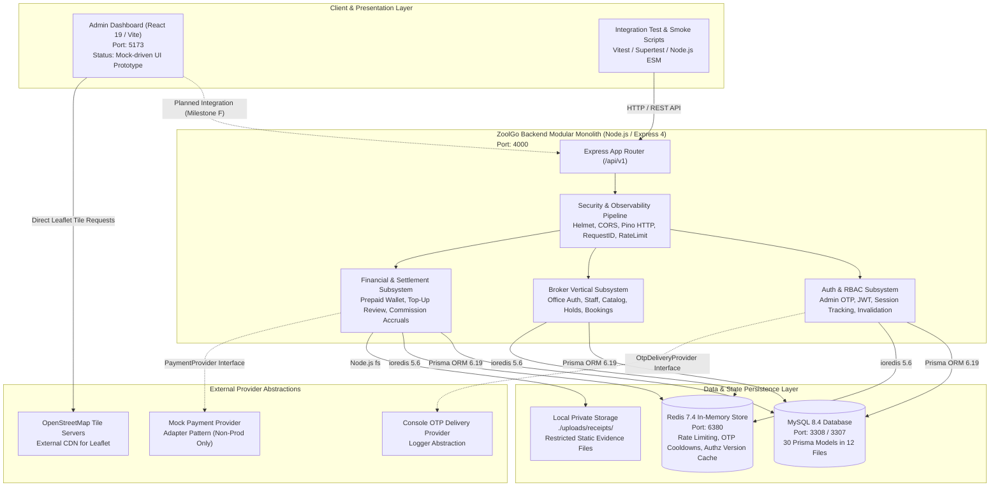
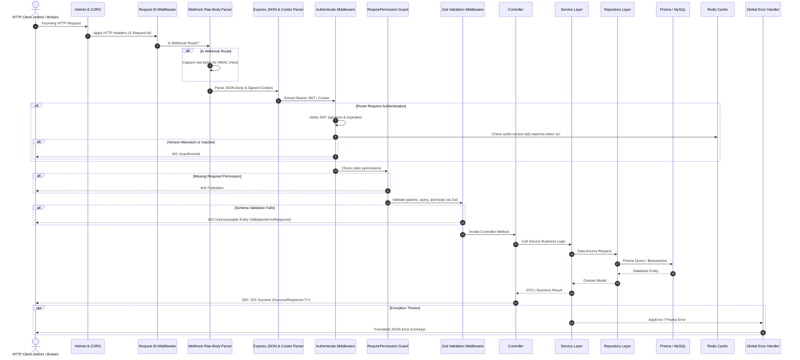
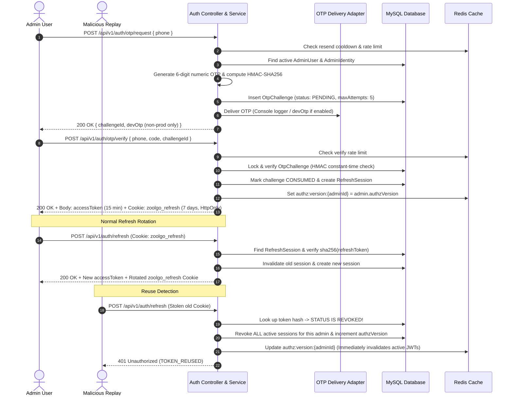
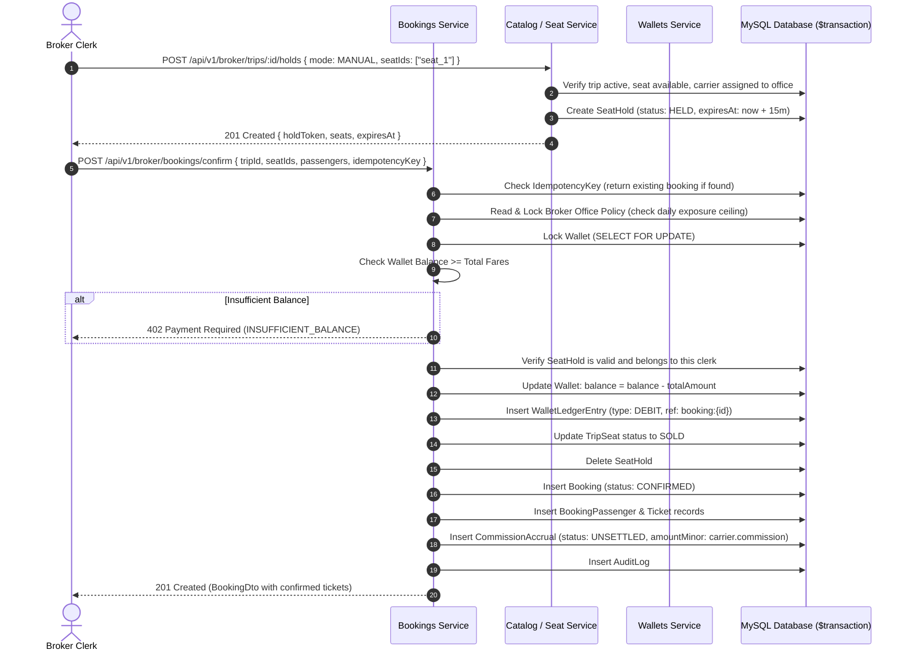
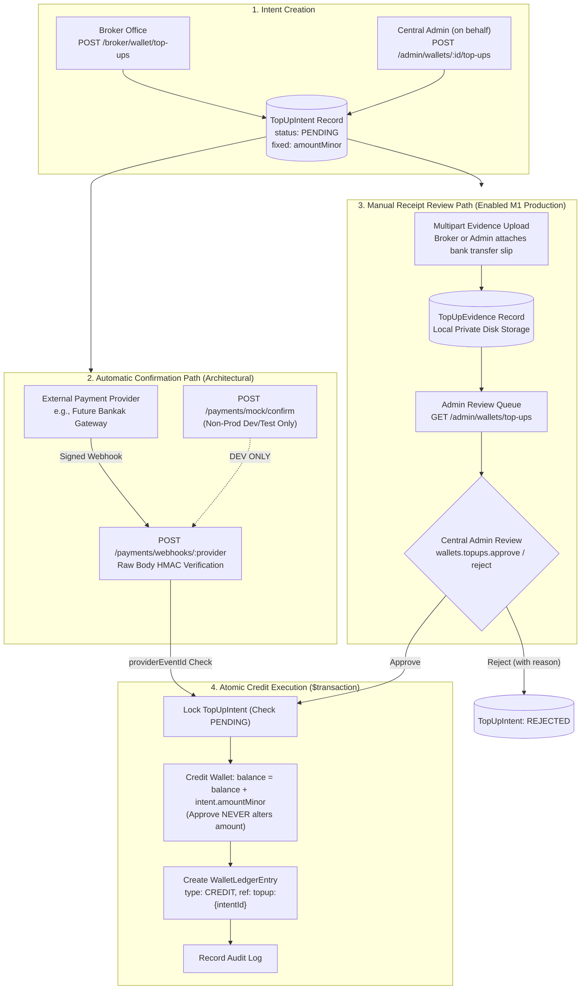
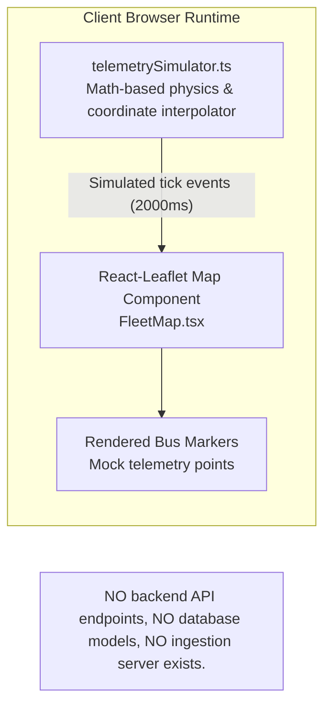
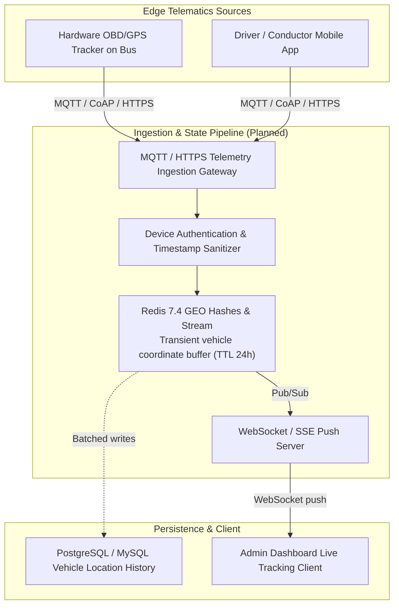

# ZoolGo — System Architecture

This document describes the high-level and detailed architecture of the ZoolGo platform. It details both the **currently implemented system** and the **planned architecture**, with clear architectural boundaries between the two.

---

## 1. High-Level System Topology (Current Implementation)

---

## 2. Backend Request Lifecycle

Every HTTP request entering `zool-go-backend` traverses an explicit, deterministic pipeline:

---

## 3. Authentication and Session Lifecycle

Admin and broker authentication uses phone OTP, short-lived JWT access tokens, rotating refresh cookies, and fail-closed Redis authorization versioning.

---

## 4. Broker Booking Transaction

The booking transaction is an atomic operation executed within a single MySQL transaction (`getPrisma().$transaction`).

---

## 5. Wallet Top-Up Confirmation Architecture (Dual Path)

Under locked decision `D-TOP-01`, ZoolGo supports two confirmation paths for the same `TopUpIntent`.

---

## 6. Commission Settlement Lifecycle

```mermaid
stateDiagram-v2
    [*] --> UNSETTLED: Booking Confirmed (CommissionAccrual created)
    
    UNSETTLED --> CLAWED_BACK: Booking Cancelled (Commission automatically reversed)
    CLAWED_BACK --> [*]

    UNSETTLED --> RESERVED: Admin creates DRAFT settlement\nPOST /admin/commissions/settlements\n(Overlapping drafts blocked with 409)
    
    RESERVED --> UNSETTLED: Admin cancels DRAFT settlement\nPOST /admin/commissions/settlements/:id/cancel\n(Accruals released back to pool)

    RESERVED --> SETTLED: Admin finalizes payout\nPOST /admin/commissions/settlements/:id/finalize\n(Idempotent; creates CommissionPayout)\nCRITICAL: Does NOT touch prepaid wallet!
    
    SETTLED --> [*]
```

---

## 7. Current vs. Future Fleet GPS Architecture

### Current Implementation (M1 Prototype)

### Planned Future Architecture (Decision `D-GPS-01` Required)

---

*Evidence citations:*
- App assembly: `d:\zool-go\zool-go-backend\src\app.ts` L32–125
- Request ID: `d:\zool-go\zool-go-backend\src\shared\middleware\request-id.ts` L1–15
- Auth middleware: `d:\zool-go\zool-go-backend\src\shared\middleware\authenticate.ts` L12–42
- Booking transaction: `d:\zool-go\zool-go-backend\src\modules\bookings\bookings.service.ts` L178–320
- Top-up locking: `d:\zool-go\zool-go-backend\src\modules\payments\payments.service.ts` L150–290
- Commission settlement: `d:\zool-go\zool-go-backend\src\modules\commissions\commissions.service.ts` L90–215
