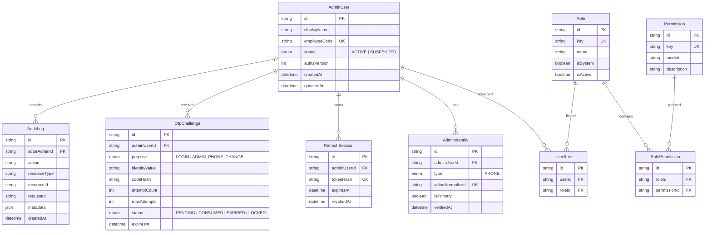
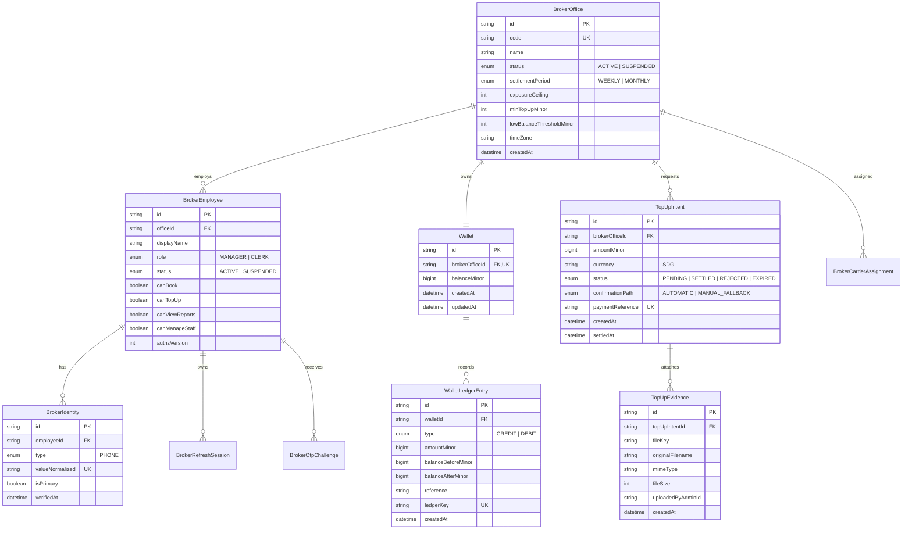
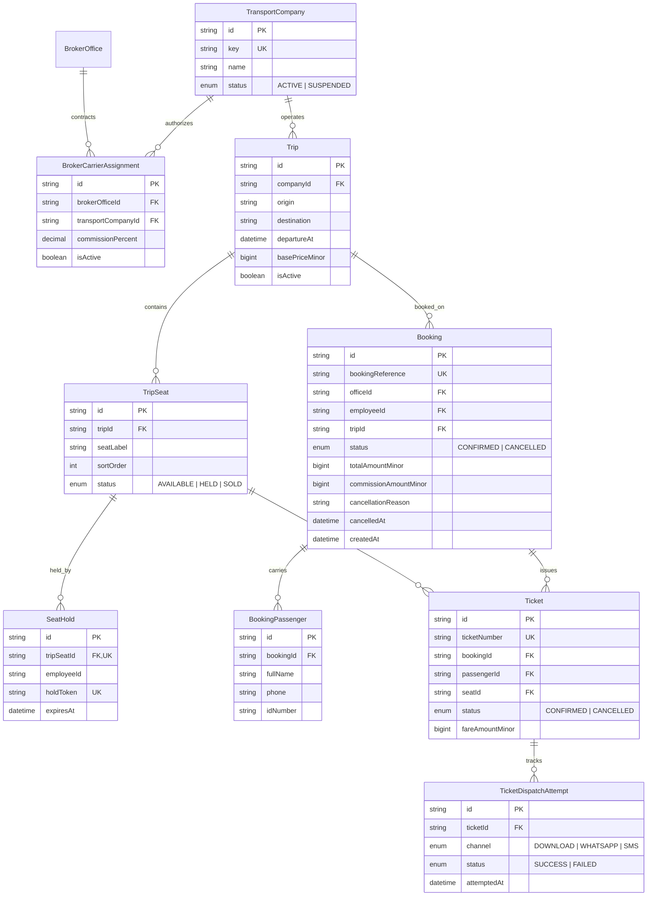
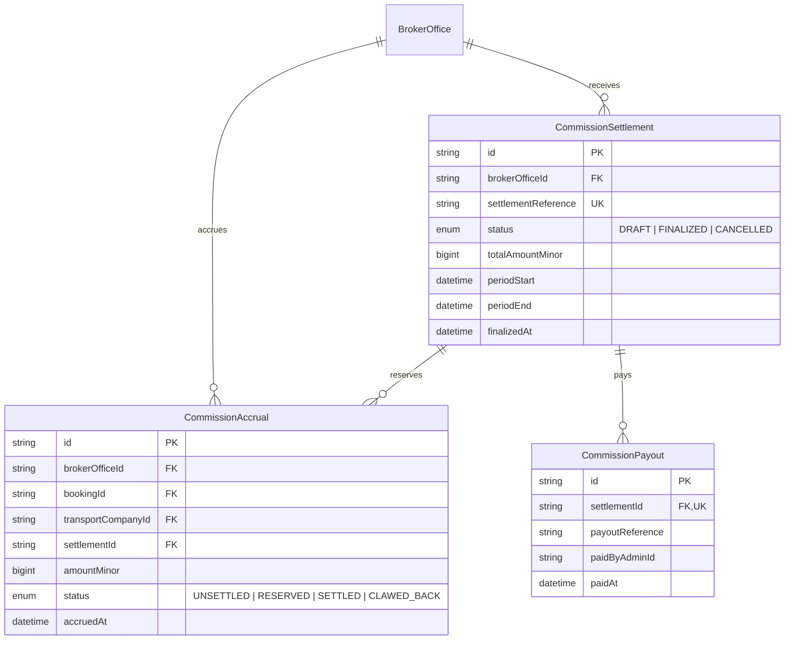

# ZoolGo — Domain Model and Database Design

This document details the relational database architecture, entity relationships, constraints, and business invariants implemented across `zool-go-backend`.

---

## 1. Database Engine and Prisma Schema Layout

- **Database Engine:** MySQL `8.4` (Docker containers `zoolgo-mysql` on port `3308` and `zoolgo-mysql-test` on port `3307`).
- **ORM & Version:** Prisma ORM `6.19.0` with `@prisma/client` `6.19.0`.
- **Schema Architecture:** Prisma multi-file schema located in `prisma/schema/`. Consists of 12 modular schema definitions:
  - `base.prisma`: Configures the MySQL datasource and client generator.
  - `admin.prisma`: Central administrator users and phone identities.
  - `rbac.prisma`: Dynamic custom roles and permission mappings.
  - `session.prisma`: Refresh session tokens and OTP login challenges.
  - `audit.prisma`: Immutable audit trail.
  - `carrier.prisma`: Transport bus companies and broker carrier assignments.
  - `broker.prisma`: Broker travel agencies, employees, identities, and sessions.
  - `wallet.prisma`: Prepaid agency wallets and double-entry ledger entries.
  - `payment.prisma`: Payment top-up intents, payment references, and evidence files.
  - `catalog.prisma`: Bus trips, individual seats, and 15-minute seat holds.
  - `booking.prisma`: Bookings, passenger details, tickets, and dispatch attempts.
  - `commission.prisma`: Broker commission accruals, period settlements, and payouts.

### Migration History (`prisma/schema/migrations/` — the single canonical folder)
> Until 2026-11-21 migrations were split across `prisma/migrations/` and `prisma/schema/migrations/`, and neither folder could build the full schema alone. They are now merged into `prisma/schema/migrations/` (the folder Prisma uses for a multi-file schema). CI verifies `migrate deploy` on a fresh DB and `migrate diff --exit-code` (no drift).

1. `20261020143911_stage1_auth_rbac`: Core admin identities, custom roles, permissions, audit logging, and sessions.
2. `20261020163529_stage2_broker_vertical`: Broker offices, employees, wallets, ledger, carriers, trips, seats, holds, bookings, commissions.
3. `20261020180000_ticket_dispatch_attempts`: Ticket dispatch attempts tracking (PDF downloads and attempts).
4. `20261023210000_stage2_6_policy_locks`: Major-to-minor money unit conversions, timezone support, and policy lock columns.
5. `20261023220000_admin_phone_change_otp`: Phone change OTP challenges and identity verification columns.
6. `20261121120000_phase2_data_model` (MASTER_PLAN phase 2, additive only): customers and drivers (identity/OTP/session), cities, stations, routes and stops, vehicles with seat layouts and amenities, trip stops and lifecycle status, booking channel (BROKER/DIRECT), round-trip groups, booking changes, payment intents and refunds, cash collections, boarding scans, vehicle positions, coupons, carrier ratings, notifications, device tokens, system settings, content pages. Existing broker columns were only made nullable or extended; nothing was dropped or renamed. New schema files: `customer`, `driver`, `geo`, `fleet`, `operations`, `sales`, `platform`.prisma.

---

## 2. Entity-Relationship Diagrams (Mermaid)

### 2.1. Domain 1: Admin Identity, RBAC, Sessions & Audit

### 2.2. Domain 2: Broker Office, Staff, Wallet & Top-Up

### 2.3. Domain 3: Carrier, Trip, Seat, Booking & Ticket

### 2.4. Domain 4: Commission Accrual, Settlement & Payout

---

## 3. Comprehensive Model Inventory (30 Models)

| Model Name | Schema File | Purpose & Responsibility | Key Fields | Invariants & Unique Constraints |
|---|---|---|---|---|
| `AdminUser` | `admin.prisma` | Platform administrative identities | `employeeCode`, `status`, `authzVersion` | `employeeCode` unique; status active/suspended. |
| `AdminIdentity` | `admin.prisma` | Login credentials for admins (phones) | `type`, `valueNormalized`, `isPrimary` | `[type, valueNormalized]` unique; only 1 primary per admin. |
| `AuditLog` | `audit.prisma` | Immutable audit trail | `actorAdminId`, `action`, `resourceId`, `requestId` | Append-only; indexes on `actorAdminId`, `action`, `resourceType`. |
| `Role` | `rbac.prisma` | Dynamic permission containers | `key`, `name`, `isSystem`, `isActive` | `key` unique; system roles protected against deletion. |
| `Permission` | `rbac.prisma` | Catalog of platform capabilities | `key`, `module`, `description` | `key` unique; matches backend `PERMISSION_CATALOG`. |
| `UserRole` | `rbac.prisma` | Admin-to-role assignment join | `userId`, `roleId` | `[userId, roleId]` unique. |
| `RolePermission` | `rbac.prisma` | Role-to-permission assignment join | `roleId`, `permissionId` | `[roleId, permissionId]` unique. |
| `RefreshSession` | `session.prisma` | Server-side refresh token records | `tokenHash`, `expiresAt`, `revokedAt` | `tokenHash` unique; rotated on use; reuse revokes all. |
| `OtpChallenge` | `session.prisma` | Temporary numeric OTP challenges | `purpose`, `identityValue`, `codeHash`, `status` | 5-minute TTL; locked after 5 failed attempts; HMAC verification. |
| `BrokerOffice` | `broker.prisma` | Commercial travel agency / broker kiosk | `code`, `name`, `status`, `exposureCeiling`, `timeZone` | `code` unique; stores policy overrides in minor units. |
| `BrokerEmployee`| `broker.prisma` | Staff member employed by a broker office | `officeId`, `role`, `status`, `canBook`, `canTopUp` | Scoped to office; capability flags determine effective permissions. |
| `BrokerIdentity`| `broker.prisma` | Login phone identity for broker staff | `employeeId`, `type`, `valueNormalized` | `[type, valueNormalized]` unique across all broker staff. |
| `BrokerRefreshSession` | `broker.prisma` | Broker employee refresh sessions | `tokenHash`, `expiresAt`, `revokedAt` | Separate cookie `zoolgo_broker_refresh`; strict principal isolation. |
| `BrokerOtpChallenge` | `broker.prisma` | Broker login OTP challenges | `identityValue`, `codeHash`, `status` | Scoped to active broker staff; HMAC validated. |
| `TransportCompany` | `carrier.prisma`| Intercity bus fleet operator | `key`, `name`, `status` | `key` unique (snake_case); status controls active bookings. |
| `BrokerCarrierAssignment` | `carrier.prisma` | Authorized carrier access for an office | `brokerOfficeId`, `transportCompanyId`, `commissionPercent` | `[brokerOfficeId, transportCompanyId]` unique; determines commission rate. |
| `Trip` | `catalog.prisma`| Scheduled intercity bus journey | `companyId`, `origin`, `destination`, `departureAt`, `basePrice` | Belongs to carrier; basePrice stored in minor units. |
| `TripSeat` | `catalog.prisma`| Physical seat on a bus trip | `tripId`, `seatLabel`, `sortOrder`, `status` | `[tripId, seatLabel]` unique; status: AVAILABLE, HELD, SOLD. |
| `SeatHold` | `catalog.prisma`| 15-minute temporary reservation on a seat | `tripSeatId`, `employeeId`, `holdToken`, `expiresAt` | `tripSeatId` unique (one hold per seat); atomic hold expiry. |
| `Booking` | `booking.prisma`| Top-level ticket purchase reservation | `bookingReference`, `officeId`, `tripId`, `status`, `totalAmountMinor` | `bookingReference` unique; atomic wallet debit; full refund on cancel. |
| `BookingPassenger` | `booking.prisma`| Traveler identity on a booking line | `bookingId`, `fullName`, `phone`, `idNumber` | Point-in-time passenger PII; independent of broker employee. |
| `Ticket` | `booking.prisma`| Individual boarding pass entitlement | `ticketNumber`, `bookingId`, `passengerId`, `seatId` | `ticketNumber` unique; status tracks booking state. |
| `TicketDispatchAttempt` | `booking.prisma` | Audit of ticket PDF downloads & dispatches | `ticketId`, `channel`, `status`, `attemptedAt` | Channel: DOWNLOAD only; WHATSAPP/SMS disabled under D-TICKET-01. |
| `Wallet` | `wallet.prisma` | Prepaid agency credit account | `brokerOfficeId`, `balanceMinor` | `brokerOfficeId` unique; 1:1 with office; balance strictly positive/zero. |
| `WalletLedgerEntry` | `wallet.prisma` | Immutable wallet transaction record | `walletId`, `type`, `amountMinor`, `balanceBefore`, `balanceAfter`, `ledgerKey` | `ledgerKey` unique (enforces idempotency); append-only. |
| `TopUpIntent` | `payment.prisma`| Top-up funding request | `brokerOfficeId`, `amountMinor`, `status`, `confirmationPath`, `paymentReference` | `paymentReference` unique; credits wallet exactly once upon settlement. |
| `TopUpEvidence` | `payment.prisma`| Uploaded bank deposit slip / receipt | `topUpIntentId`, `fileKey`, `mimeType`, `fileSize` | Private local storage; protected download requiring permission. |
| `CommissionAccrual` | `commission.prisma` | Earned agency sales commission record | `brokerOfficeId`, `bookingId`, `amountMinor`, `status`, `settlementId` | Accrues per confirmed booking; clawed back on cancellation. |
| `CommissionSettlement` | `commission.prisma` | Periodic commission payout batch | `brokerOfficeId`, `settlementReference`, `status`, `totalAmountMinor` | `settlementReference` unique; DRAFT reserves accruals; no overlap. |
| `CommissionPayout` | `commission.prisma` | Record of finalized manual commission payment | `settlementId`, `payoutReference`, `paidByAdminId` | 1:1 with settlement; does NOT credit wallet. |

---

## 4. Critical Database and Financial Invariants

1. **Idempotent Top-Up Credit:** A `TopUpIntent` can transition to `SETTLED` exactly once. The database enforces `unique(paymentReference)`. The ledger entry is locked to `ledgerKey = topup:{intentId}`.
2. **Double-Entry Balance Coherence:** In `WalletLedgerEntry`, `balanceAfterMinor = balanceBeforeMinor + amountMinor` (for `CREDIT`) or `balanceBeforeMinor - amountMinor` (for `DEBIT`). The current `Wallet.balanceMinor` must equal the latest ledger entry's `balanceAfterMinor`.
3. **No Overlapping Settlement Drafts:** A broker office can have at most one active `DRAFT` settlement. Creating a new draft checks for existing drafts and rejects with `409 Conflict`.
4. **Commission Clawback Consistency:** Cancelling a booking updates the related `CommissionAccrual` status from `UNSETTLED` to `CLAWED_BACK`. Accruals already reserved in a `DRAFT` or `FINALIZED` settlement trigger compensation or dispute handling.
5. **Atomic Seat Allocation:** `TripSeat.status` transitions from `AVAILABLE -> HELD -> SOLD`. An atomic conditional update (`WHERE status = AVAILABLE`) prevents concurrent holding or double-booking.
6. **Deny-by-Default Authorization:** Adding a new permission key to `PERMISSION_CATALOG` does not grant it to any existing role (except during clean database bootstrap seeding to `super_admin`). Custom roles require explicit admin assignment.

---

*Evidence citations:*
- Prisma schemas: `d:\zool-go\zool-go-backend\prisma\schema\*.prisma`
- Ledger invariants: `d:\zool-go\zool-go-backend\src\modules\wallets\wallets.repository.ts` L30–75
- Booking transaction: `d:\zool-go\zool-go-backend\src\modules\bookings\bookings.service.ts` L220–305
- Settlement reservation: `d:\zool-go\zool-go-backend\src\modules\commissions\commissions.service.ts` L75–140
